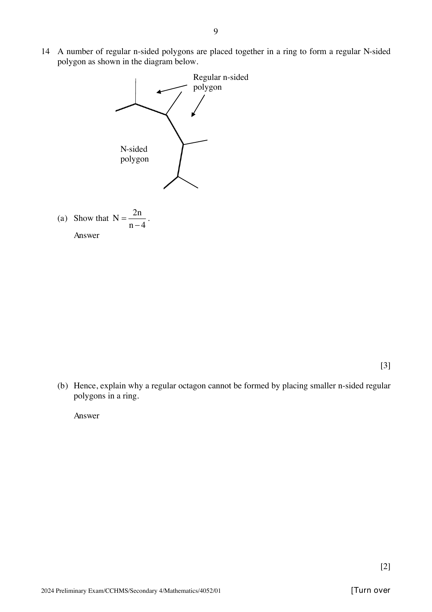

## Question

> **Marks:** (a) 3, (b) 2; total 5
> **Page:** 9

A number of regular $n$-sided polygons are placed together in a ring to form a regular $N$-sided polygon as shown in the diagram below.

**(a)** Show that $N = \dfrac{2n}{n-4}$.

**(b)** Hence, explain why a regular octagon cannot be formed by placing smaller $n$-sided regular polygons in a ring.

## Answer Scheme

**(a)**

$$
\frac{180(n-2)}{n}\times 2+\frac{180(N-2)}{N} = 360
$$

$$
2N(n-2)+n(N-2) = 2nN
$$

$$
2n = nN-4N, \quad N(n-4) = 2n, \quad N = \frac{2n}{n-4}
$$

Alternative on the scheme uses the exterior angle of the $N$-sided polygon, $\dfrac{360}{N}$, and reaches the same result.

**(b)**

$$
\frac{2n}{n-4} = 8, \quad n = \frac{16}{3}
$$

It is not an octagon as $n$ is not an integer.
