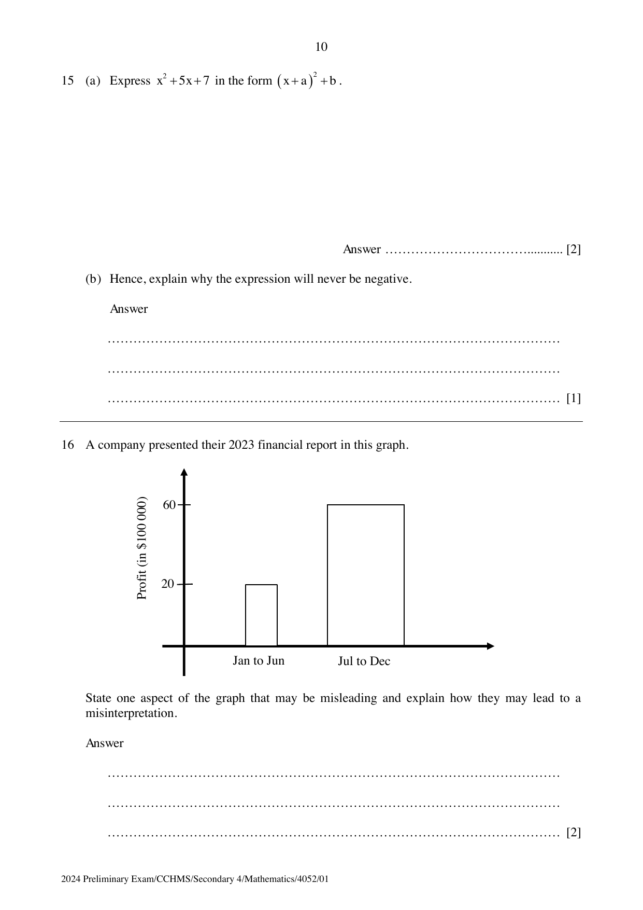

## Question

> **Marks:** 2
> **Page:** 10

A company presented their 2023 financial report in this graph.

State one aspect of the graph that may be misleading and explain how they may lead to a misinterpretation.

## Answer Scheme

Each bar in the graph should be of the same width. The different widths of each bar will lead readers to misinterpretation such as interpreting a wider bar to mean a profit of a larger proportion than it actually is.
