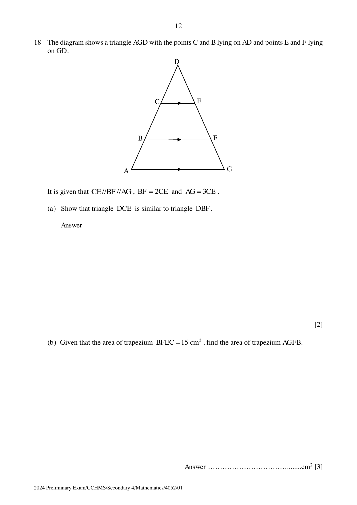

## Question

> **Marks:** (a) 2, (b) 3; total 5
> **Page:** 12

The diagram shows a triangle $AGD$ with the points $C$ and $B$ lying on $AD$ and points $E$ and $F$ lying on $GD$.

It is given that $CE \parallel BF \parallel AG$, $BF = 2CE$ and $AG = 3CE$.

**(a)** Show that triangle $DCE$ is similar to triangle $DBF$.

**(b)** Given that the area of trapezium $BFEC = 15\text{ cm}^{2}$, find the area of trapezium $AGFB$.

## Answer Scheme

**(a)** $\angle DCE = \angle DBF$ (corresponding angles). $\angle CDE = \angle BDE$ (common angle). Therefore triangle $DCE$ is similar to triangle $DBF$.

**(b)**

$$
\frac{\text{area of }\triangle DCE}{\text{area of }\triangle DBF} = \left(\frac{1}{2}\right)^{2} = \frac{1}{4}
$$

$$
\frac{\text{area of }\triangle DCE}{\text{area of }\triangle DAG} = \left(\frac{1}{3}\right)^{2} = \frac{1}{9}
$$

$$
\frac{\text{area of trapezium } AGFB}{\text{area of trapezium } BFEC} = \frac{9-4}{4-1} = \frac{5}{3}
$$

$$
\text{area of trapezium } AGFB = 25\text{ cm}^{2}
$$
