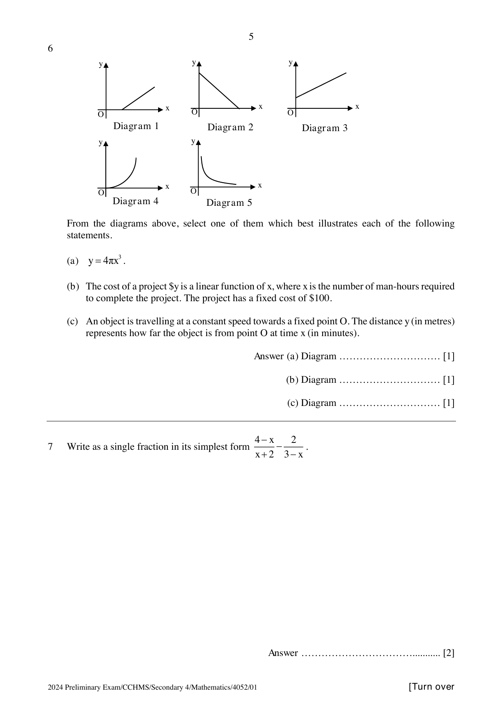

## Question

> **Marks:** (a) 1, (b) 1, (c) 1; total 3
> **Page:** 5

From the diagrams above, select one of them which best illustrates each of the following statements.

**(a)** $y = 4\pi x^{3}$.

**(b)** The cost of a project ＄$y$ is a linear function of $x$, where $x$ is the number of man-hours required to complete the project. The project has a fixed cost of ＄100.

**(c)** An object is travelling at a constant speed towards a fixed point $O$. The distance $y$ (in metres) represents how far the object is from point $O$ at time $x$ (in minutes).

## Answer Scheme

**(a)** Diagram 4.

**(b)** Diagram 3.

**(c)** Diagram 2.
