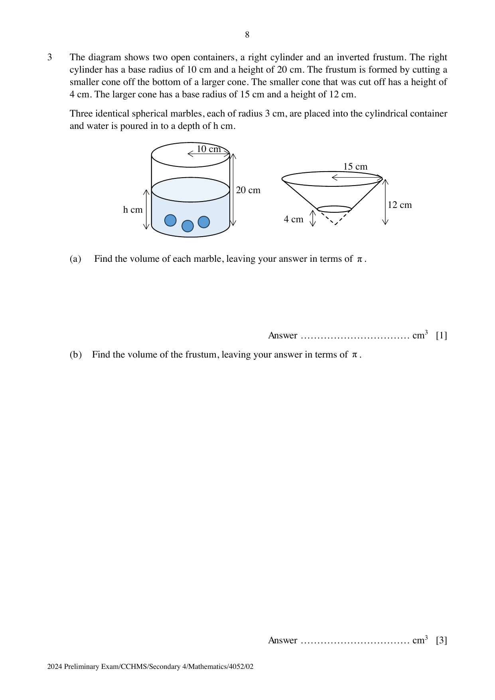

## Question

> **Marks:** (a) 1, (b) 3, (c) 3, (d) 6; total 13
> **Page:** 8–9

The diagram shows two open containers, a right cylinder and an inverted frustum. The right cylinder has a base radius of 10 cm and a height of 20 cm. The frustum is formed by cutting a smaller cone off the bottom of a larger cone. The smaller cone that was cut off has a height of 4 cm. The larger cone has a base radius of 15 cm and a height of 12 cm. Three identical spherical marbles, each of radius 3 cm, are placed into the cylindrical container and water is poured in to a depth of $h$ cm.

**(a)** Find the volume of each marble, leaving your answer in terms of $\pi$. [1]

**(b)** Find the volume of the frustum, leaving your answer in terms of $\pi$. [3]

**(c)** All the water from the cylinder, without the marbles, is then poured into the empty frustum, filling it completely without any overflow. Find the value of $h$, correct to two decimal places. [3]

**(d)** The exterior surface area of each container is painted. Find the total area painted. [6]

## Answer Scheme

**(a)** $\dfrac{4}{3}\pi(3)^{3} = 36\pi\text{ cm}^{3}$.

**(b)** Volume of the large cone $= \dfrac{1}{3}\pi(15)^{2}(12) = 900\pi\text{ cm}^{3}$.

$$
\frac{V_{1}}{900\pi} = \left(\frac{4}{12}\right)^{3}, \quad V_{1} = \frac{100}{3}\pi\text{ cm}^{3}
$$

Volume of frustum $= 900\pi-\dfrac{100}{3}\pi = \dfrac{2600}{3}\pi\text{ cm}^{3}$.

**(c)**

$$
\frac{2600}{3}\pi+3(36\pi) = \frac{2924}{3}\pi
$$

$$
\pi(10)^{2}h = \frac{2924}{3}\pi, \quad h = 9.75
$$

**(d)** Slant height of the large cone $l = \sqrt{12^{2}+15^{2}} = \sqrt{369}\text{ cm}$.

Curved surface of the large cone $= \pi(15)\sqrt{369} = 905.22036\ldots\text{ cm}^{2}$.

Small-cone curved surface $= 100.58004\ldots\text{ cm}^{2}$, and its base radius is $5\text{ cm}$.

Frustum surface $= (905.22036\ldots-100.58004\ldots)+\pi(5)^{2} = 883.18013\ldots\text{ cm}^{2}$.

$$
883.18013\ldots+(2\times 10\times\pi\times 20)+\pi(10)^{2} = 2450\text{ cm}^{2}\text{ (3 s.f.)}
$$
