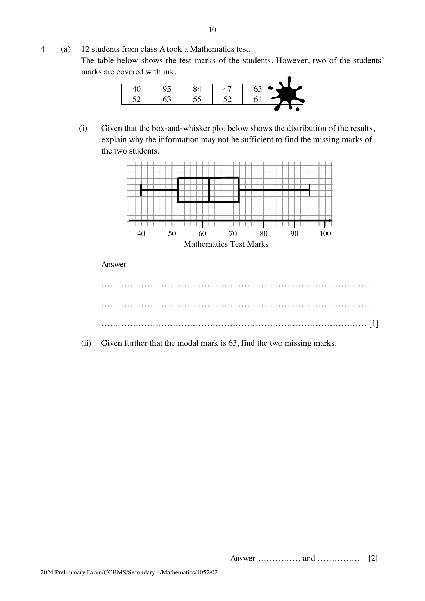
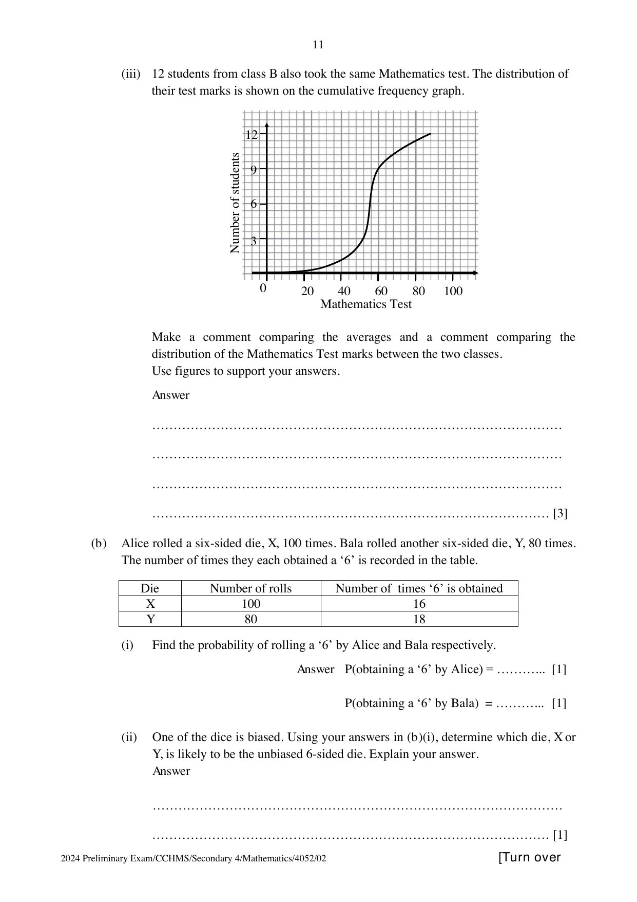

## Question

> **Marks:** (a)(i) 1, (a)(ii) 2, (a)(iii) 3, (b)(i) 2, (b)(ii) 1; total 9
> **Page:** 10–11

**(a)** 12 students from class A took a Mathematics test. The table below shows the test marks of the students. However, two of the students’ marks are covered with ink.

$$
40,\ 95,\ 84,\ 47,\ 63,\ 52,\ 63,\ 55,\ 52,\ 61
$$

**(i)** Given that the box-and-whisker plot below shows the distribution of the results, explain why the information may not be sufficient to find the missing marks of the two students. [1]

**(ii)** Given further that the modal mark is 63, find the two missing marks. [2]

**(iii)** 12 students from class B also took the same Mathematics test. The distribution of their test marks is shown on the cumulative frequency graph.

Make a comment comparing the averages and a comment comparing the distribution of the Mathematics test marks between the two classes. Use figures to support your answers. [3]

**(b)** Alice rolled a six-sided die, $X$, 100 times. Bala rolled another six-sided die, $Y$, 80 times. The number of times they each obtained a ‘6’ is recorded in the table.

| Die | Number of rolls | Number of times ‘6’ is obtained |
| --- | --- | --- |
| $X$ | 100 | 16 |
| $Y$ | 80 | 18 |

**(i)** Find the probability of rolling a ‘6’ by Alice and Bala respectively. [2]

**(ii)** One of the dice is biased. Using your answers in (b)(i), determine which die, $X$ or $Y$, is likely to be the unbiased 6-sided die. Explain your answer. [1]

## Answer Scheme

**(a)(i)** The box-and-whisker plot is not able to provide individual data points. It can only provide the minimum, maximum mark, and the 25th, 50th and 75th percentiles, and these data are insufficient to calculate the missing marks.

**(a)(ii)** Since the mode is 63, one missing mark is 63. Ordered marks include $63, 63, 63$ and a gap before 84. The upper quartile is 72, so $\dfrac{63+x}{2} = 72$ and $x = 81$. The missing marks are 63 and 81.

**(a)(iii)** Generally, class A did better. The median of class A is 62 marks, which is higher than the median of class B, which is 56 marks.

Interquartile range of class A $= 72-52 = 20$. Interquartile range of class B $= 60-52 = 8$. Class A’s marks are more spread out than class B’s.

**(b)(i)** Alice: $\dfrac{16}{100} = \dfrac{4}{25}$ or $0.16$. Bala: $\dfrac{18}{80} = \dfrac{9}{40}$ or $0.225$.

**(b)(ii)** Alice’s die ($X$) is more likely to be an unbiased die as the probability of getting a ‘6’ is closer to that of an unbiased die.
