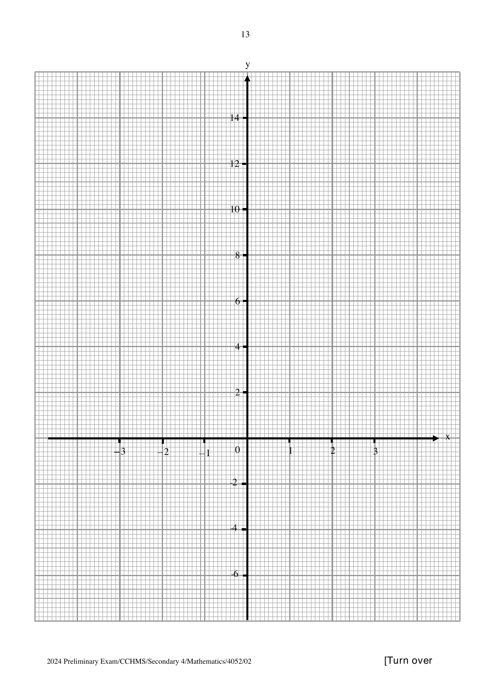

## Question

> **Marks:** (a) 1, (b) 3, (c)(i) 1, (c)(ii) 2, (c)(iii) 3; total 10
> **Page:** 12–13

**(a)** Complete the table of values for $y = \dfrac{2}{x^{2}}-2x$. Values are given to one decimal place where appropriate. [1]

| $x$ | $-3$ | $-2$ | $-1$ | $-0.5$ | $-0.4$ | $0.5$ | $1$ | $2$ | $3$ |
| --- | --- | --- | --- | --- | --- | --- | --- | --- | --- |
| $y$ |  | $4.5$ | $4$ | $9$ | $13.3$ | $7$ | $0$ | $-3.5$ | $-5.8$ |

**(b)** On the grid, draw the graph of $y = \dfrac{2}{x^{2}}-2x$ for $-3 \leq x \leq 3$. [3]

**(c)(i)** On the same grid, draw the graph of $y+x = 6$ for $-3 \leq x \leq 3$. [1]

**(ii)** Write down the $x$-coordinates of the points where the line intersects the curve. [2]

**(iii)** These values of $x$ are solutions of the equation $x^{3}+Ax^{2}+B = 0$. Find the value of $A$ and of $B$. [3]

## Answer Scheme

**(a)** When $x = -3$, $y = 6.2$.

**(b)** Curve of $y = \dfrac{2}{x^{2}}-2x$ for $-3 \leq x \leq 3$.

**(c)(i)** Line through $(-3, 9)$ and $(3, 3)$.

**(c)(ii)** $x = -0.6$ and $x = 0.55$.

**(c)(iii)**

$$
6-x = \frac{2}{x^{2}}-2x
$$

$$
6x^{2}-x^{3} = 2-2x^{3}, \quad x^{3}+6x^{2}-2 = 0
$$

$A = 6$, $B = -2$.
