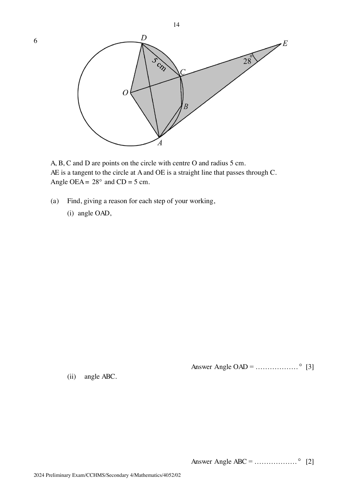

## Question

> **Marks:** (a)(i) 3, (a)(ii) 2, (b) 4; total 9
> **Page:** 14–15

$A$, $B$, $C$ and $D$ are points on the circle with centre $O$ and radius 5 cm. $AE$ is a tangent to the circle at $A$ and $OE$ is a straight line that passes through $C$. $\angle OEA = 28^{\circ}$ and $CD = 5\text{ cm}$.

**(a)** Find, giving a reason for each step of your working,

**(i)** $\angle OAD$, [3]

**(ii)** $\angle ABC$. [2]

**(b)** Find the area of the shaded region. [4]

## Answer Scheme

**(a)(i)** $\angle OAE = 90^{\circ}$ (tangent perpendicular to radius).

$\angle COA = 180^{\circ}-90^{\circ}-28^{\circ} = 62^{\circ}$ (angle sum of triangle).

$\angle COD = 60^{\circ}$ (angle in an equilateral triangle).

$\angle AOD = 122^{\circ}$.

$$
\angle OAD = \frac{180^{\circ}-122^{\circ}}{2} = 29^{\circ}
$$

(base angles of an isosceles triangle).

**(a)(ii)** Reflex $\angle COA = 298^{\circ}$ (angles at a point).

$$
\angle ABC = \frac{298^{\circ}}{2} = 149^{\circ}
$$

(angle at the centre $= 2\times$ angle at the circumference).

**(b)**

$$
\text{Area of sector } OCD = \frac{60}{360}\pi(5)^{2} = \frac{25}{6}\pi = 13.089969\ldots\text{ cm}^{2}
$$

$$
\tan 28^{\circ} = \frac{5}{AE}, \quad \text{area of triangle} = \frac{1}{2}\times\frac{5}{\tan 28^{\circ}}\times 5 = 23.50908\ldots\text{ cm}^{2}
$$

Shaded area $= 36.6\text{ cm}^{2}$ (3 s.f.).
