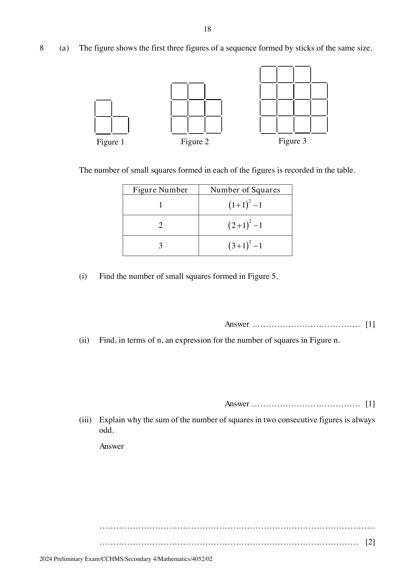

## Question

> **Marks:** (a)(i) 1, (a)(ii) 1, (a)(iii) 2, (b) 2; total 6
> **Page:** 18–19

**(a)** The figure shows the first three figures of a sequence formed by sticks of the same size.

The number of small squares formed in each of the figures is recorded in the table.

| Figure number | Number of squares |
| --- | --- |
| 1 | $(1+1)^{2}-1$ |
| 2 | $(2+1)^{2}-1$ |
| 3 | $(3+1)^{2}-1$ |

**(i)** Find the number of small squares formed in Figure 5. [1]

**(ii)** Find, in terms of $n$, an expression for the number of squares in Figure $n$. [1]

**(iii)** Explain why the sum of the number of squares in two consecutive figures is always odd. [2]

**(b)** The table below shows the $n$th terms of 4 sequences.

| Sequence number | $n$th term |
| --- | --- |
| 1 | $4n+3$ |
| 2 | $7n+1$ |
| 3 | $14n$ |
| 4 | $8n-1$ |

For each sequence, are the numbers in the sequence always multiples of 7, sometimes multiples of 7 or never multiples of 7? Write down the letter ‘A’, ‘S’ or ‘N’.

- A: always multiples of 7
- S: sometimes multiples of 7
- N: never multiples of 7

[2]

## Answer Scheme

**(a)(i)** Figure 5 has 35 small squares.

**(a)(ii)** $(n+1)^{2}-1$.

**(a)(iii)**

$$
\left((n+1)^{2}-1\right)+\left((n+2)^{2}-1\right) = 2n^{2}+6n+3 = 2(n^{2}+3n)+3
$$

$2(n^{2}+3n)$ is even and 3 is odd, so the sum is always odd.

**(b)** Sequence 1: S. Sequence 2: N. Sequence 3: A. Sequence 4: S.
