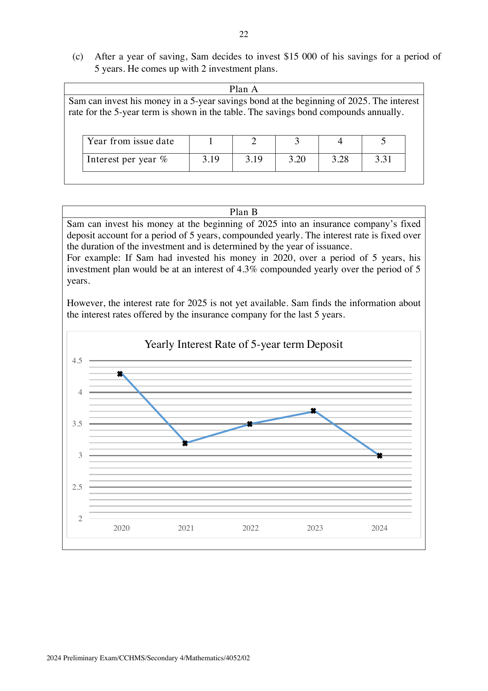

## Question

> **Marks:** (a) 1, (b) 4, (c) 5; total 10
> **Page:** 20–23

Sam is a 40-year-old man who earns a gross salary of ＄8000 a month. He is a Singaporean and an employee of a Singapore firm. Sam is required to put a certain percentage of his monthly gross salary into his Central Provident Fund (CPF) account. CPF is a mandatory savings scheme funded by contributions from employers and employees.

| Employee’s age (years) | Total (% of gross salary) | By employer (% of gross salary) | By employee (% of gross salary) |
| --- | --- | --- | --- |
| 55 and below | 37 | 17 | 20 |
| Above 55 to 60 | 31 | 15 | 16 |
| Above 60 to 65 | 22 | 11.5 | 10.5 |
| Above 65 to 70 | 16.5 | 9 | 7.5 |
| Above 70 | 12.5 | 7.5 | 5 |

CPF contribution rates from 1 January 2024, for monthly gross salary greater than ＄750.

**(a)** Find the amount of money Sam’s employer must contribute to his CPF monthly. [1]

Sam wants to plan his monthly savings. He hopes to save at least 20% of his salary each month after CPF deductions.

| Expenditure | Amount (＄) |
| --- | --- |
| Food and groceries | 820 |
| Transportation | 90 |
| Insurance and healthcare | 1000 |
| Phone and internet subscriptions | 80 |
| Utilities | 300 |
| Housing loan | 1000 |
| Leisure and entertainment (movies, sports, books subscription fees, dining etc) | 1580 |

**(b)** Determine whether Sam is able to achieve his saving goals by clearly showing your calculations. [4]

**(c)** After a year of saving, Sam decides to invest ＄15 000 of his savings for a period of 5 years. He comes up with 2 investment plans.

**Plan A.** Sam can invest his money in a 5-year savings bond at the beginning of 2025. The interest rate for the 5-year term is shown in the table. The savings bond compounds annually.

| Year from issue date | 1 | 2 | 3 | 4 | 5 |
| --- | --- | --- | --- | --- | --- |
| Interest per year % | 3.19 | 3.19 | 3.20 | 3.28 | 3.31 |

**Plan B.** Sam can invest his money at the beginning of 2025 into an insurance company’s fixed deposit account for a period of 5 years, compounded yearly. The interest rate is fixed over the duration of the investment and is determined by the year of issuance. For example, if Sam had invested his money in 2020, over a period of 5 years, his investment plan would be at an interest of 4.3% compounded yearly over the period of 5 years.

However, the interest rate for 2025 is not yet available. Sam finds the information about the interest rates offered by the insurance company for the last 5 years.

Determine which plan Sam should choose. Justify the decision you make and show your calculations clearly. [5]

## Answer Scheme

**(a)** $\dfrac{17}{100}\times 8000 = 1360$. ＄1360.

**(b)** Employee CPF $= \dfrac{20}{100}\times 8000 = 1600$.

Total expenditure $= 820+90+1000+80+300+1000+1580 = 4870$.

Savings $= 8000-1600-4870 = 1530$.

$$
\frac{1530}{8000-1600}\times 100\% = 23.9\%\text{ (3 s.f.)}
$$

Since $23.9\% > 20\%$, Sam is able to save the amount he hopes to.

**(c)** Plan A grows to ＄17587.53 (nearest cent):

$$
15000\left(1+\frac{3.19}{100}\right)^{2} = 15972.26415\ldots
$$

then multiply in turn by $1.032$, $1.0328$ and $1.0331$.

Plan B uses the graph readings $4.3,\ 3.2,\ 3.5,\ 3.7,\ 3$. Average interest rate $= 3.54\%$.

$$
15000\left(1+\frac{3.54}{100}\right)^{5} = 17849.75
$$

(nearest cent). Since ＄17849.75 is greater than ＄17587.53, Sam should consider Plan B.
