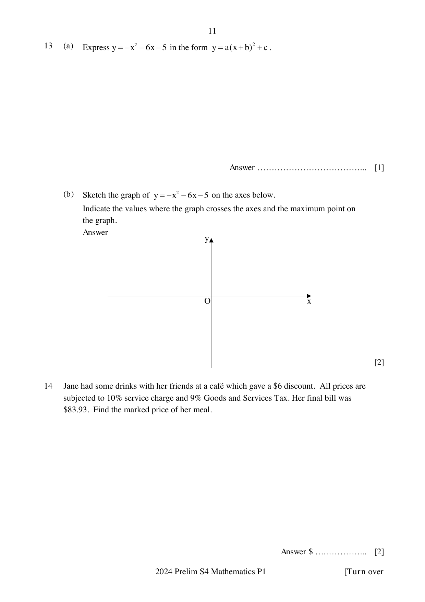

## Question

> **Marks:** 3
> **Page:** 11

(a) Express $y = -x^{2}-6x-5$ in the form $y = a(x+b)^{2}+c$. [1]

(b) Sketch the graph of $y = -x^{2}-6x-5$ on the axes below.
Indicate the values where the graph crosses the axes and the maximum point on the graph. [2]

