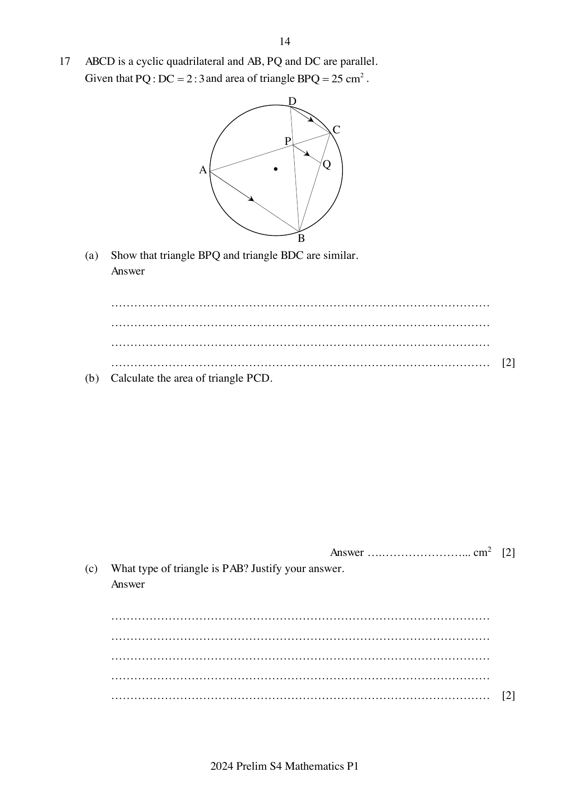

## Question

> **Marks:** 6
> **Page:** 14

$ABCD$ is a cyclic quadrilateral and $AB$, $PQ$ and $DC$ are parallel.
Given that $PQ : DC = 2 : 3$ and area of triangle $BPQ = 25$ cm$^{2}$.

(a) Show that triangle $BPQ$ and triangle $BDC$ are similar. [2]

(b) Calculate the area of triangle $PCD$. [2]

(c) What type of triangle is $PAB$? Justify your answer. [2]
