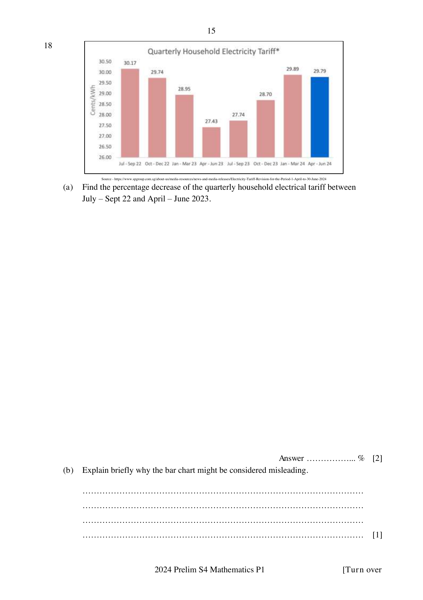

## Question

> **Marks:** 3
> **Page:** 15

The bar chart is titled "Quarterly Household Electricity Tariff" (cents/kWh). Printed bar values: Jul–Sep 22: $30.17$; Oct–Dec 22: $29.74$; Jan–Mar 23: $28.95$; Apr–Jun 23: $27.43$; Jul–Sep 23: $27.74$; Oct–Dec 23: $28.70$; Jan–Mar 24: $29.89$; Apr–Jun 24: $29.79$. The vertical scale starts at $26.00$.

Source: https://www.spgroup.com.sg/about-us/media-resources/news-and-media-releases/Electricity-Tariff-Revision-for-the-Period-1-April-to-30-June-2024

(a) Find the percentage decrease of the quarterly household electrical tariff between July – Sept 22 and April – June 2023. [2]

(b) Explain briefly why the bar chart might be considered misleading. [1]
