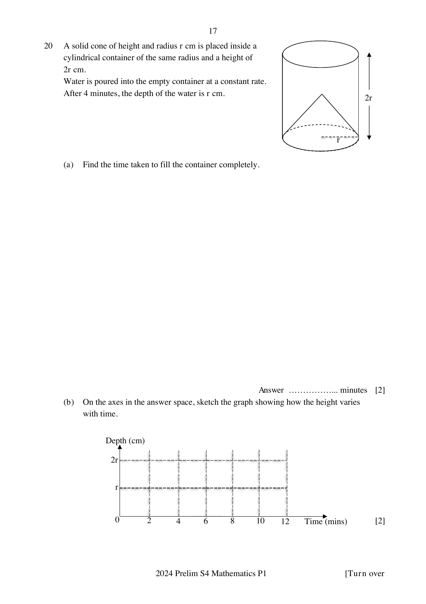

## Question

> **Marks:** 4
> **Page:** 17

A solid cone of height and radius $r$ cm is placed inside a cylindrical container of the same radius and a height of $2r$ cm.
Water is poured into the empty container at a constant rate.
After $4$ minutes, the depth of the water is $r$ cm.

(a) Find the time taken to fill the container completely. [2]

(b) On the axes in the answer space, sketch the graph showing how the height varies with time. [2]

The printed axes are depth (cm) against time (mins), with horizontal guides at $r$ and $2r$ and vertical guides at $0, 2, 4, 6, 8, 10, 12$. The cone stands base-down inside the cylinder.

