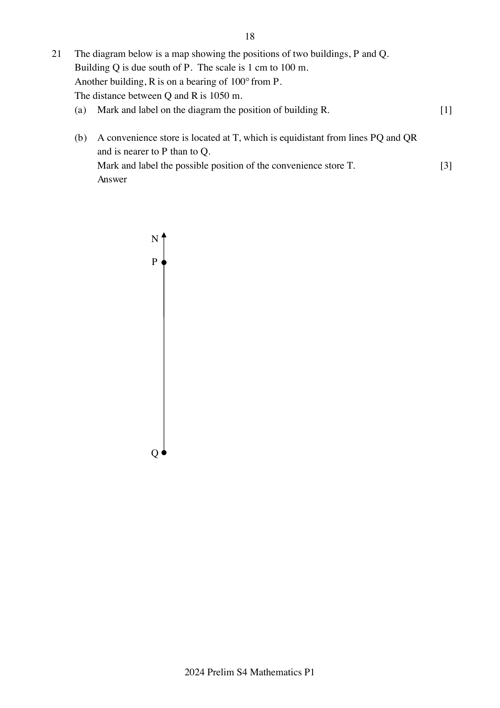

## Question

> **Marks:** 4
> **Page:** 18

The diagram below is a map showing the positions of two buildings, $P$ and $Q$.
Building $Q$ is due south of $P$. The scale is $1$ cm to $100$ m.
Another building, $R$ is on a bearing of $100^{\circ}$ from $P$.
The distance between $Q$ and $R$ is $1050$ m.

(a) Mark and label on the diagram the position of building $R$. [1]

(b) A convenience store is located at $T$, which is equidistant from lines $PQ$ and $QR$ and is nearer to $P$ than to $Q$.
Mark and label the possible position of the convenience store $T$. [3]
