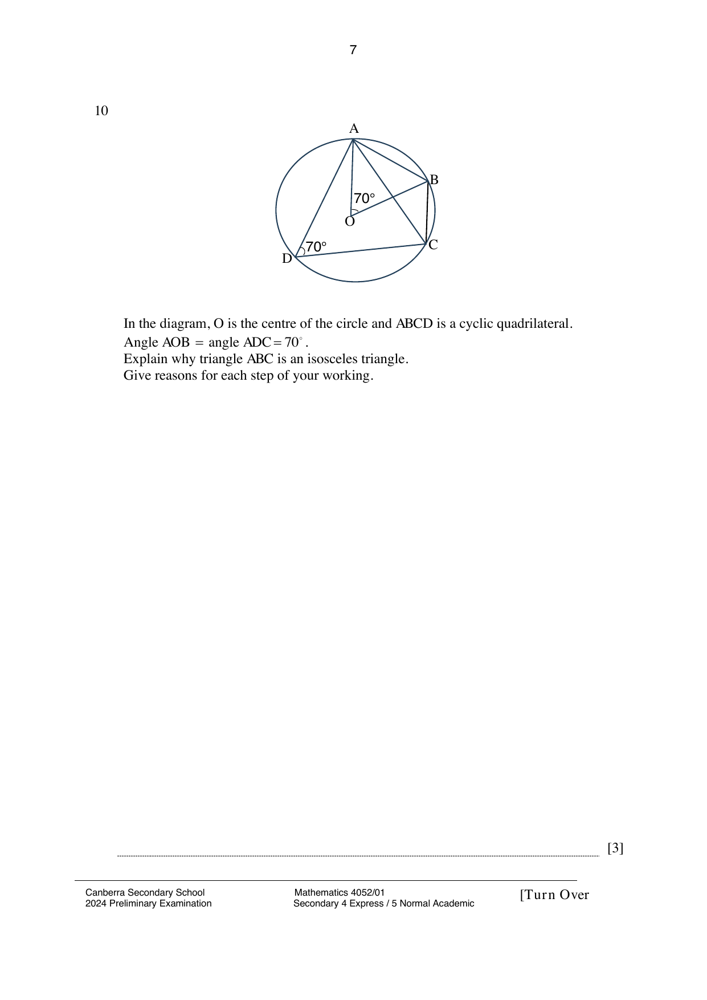

## Question

> **Marks:** 3
> **Page:** 7

In the diagram, $O$ is the centre of the circle and $ABCD$ is a cyclic quadrilateral.
Angle $AOB =$ angle $ADC = 70^{\circ}$.
Explain why triangle $ABC$ is an isosceles triangle.
Give reasons for each step of your working. [3]

## Answer Scheme

$$
\angle ACB = \frac{70^{\circ}}{2} = 35^{\circ}
$$

(angle at centre $=$ twice the angle at circumference).

$$
\angle ABC = 180^{\circ}-70^{\circ} = 110^{\circ}
$$

(angles in opposite segments).

$$
\angle BAC = 180^{\circ}-110^{\circ}-35^{\circ} = 35^{\circ}
$$

(angle sum of triangle).

Since $\angle ACB = \angle BAC$, triangle $ABC$ is an isosceles triangle.
