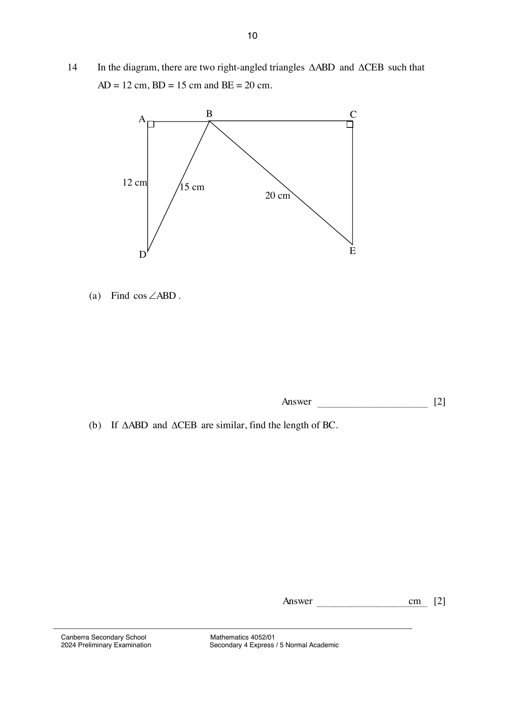

## Question

> **Marks:** (a) 2, (b) 2; total 4
> **Page:** 10

In the diagram, there are two right-angled triangles $\triangle ABD$ and $\triangle CEB$ such that $AD = 12\text{ cm}$, $BD = 15\text{ cm}$ and $BE = 20\text{ cm}$.

**(a)** Find $\cos\angle ABD$. [2]

**(b)** If $\triangle ABD$ and $\triangle CEB$ are similar, find the length of $BC$. [2]

## Answer Scheme

**(a)**

$$
AB = \sqrt{15^{2}-12^{2}} = \sqrt{81} = 9
$$

$$
\cos\angle ABD = \frac{9}{15} = \frac{3}{5}
$$

**(b)**

$$
\frac{BC}{DA} = \frac{BE}{DB}, \quad \frac{BC}{12} = \frac{20}{15}, \quad BC = 16\text{ cm}
$$
