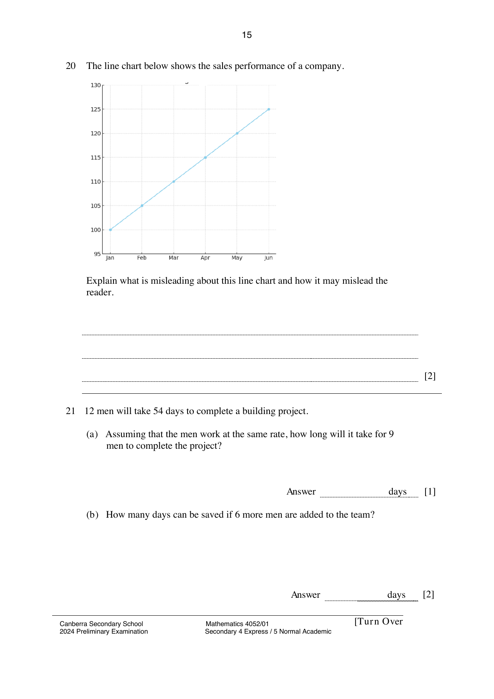

## Question

> **Marks:** 2
> **Page:** 15

The line chart below shows the sales performance of a company.

Explain what is misleading about this line chart and how it may mislead the reader. [2]

## Answer Scheme

The $y$-axis of the line chart does not start from zero and the reader may be misled to think that the sales performance has increased greatly from Jan to Jun.
