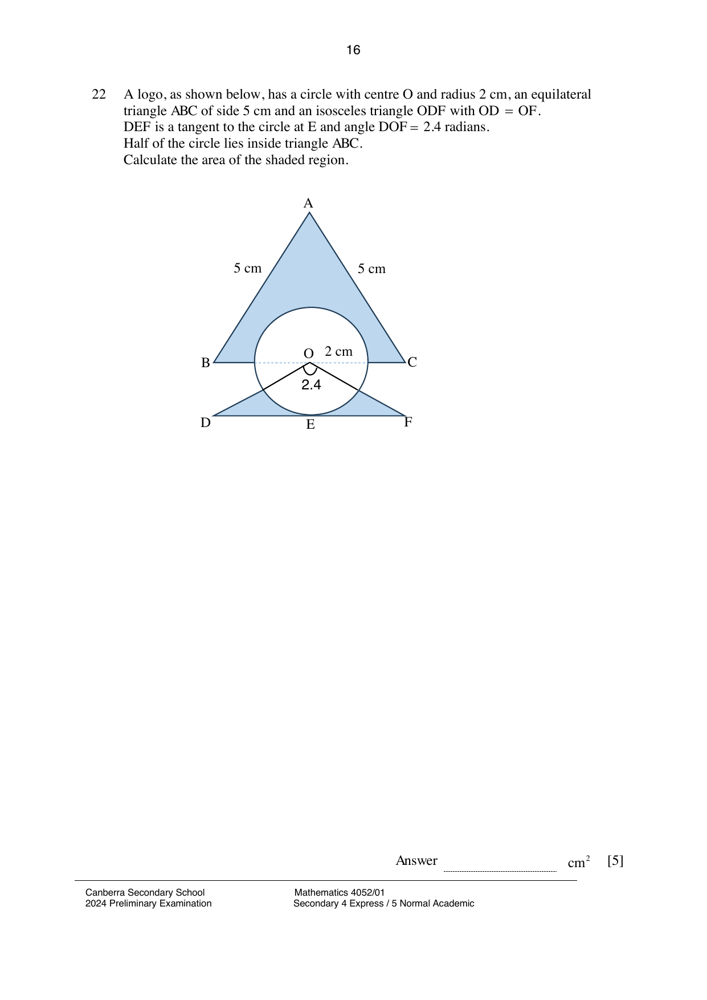

## Question

> **Marks:** 5
> **Page:** 16

A logo, as shown below, has a circle with centre $O$ and radius 2 cm, an equilateral triangle $ABC$ of side 5 cm and an isosceles triangle $ODF$ with $OD = OF$.
$DEF$ is a tangent to the circle at $E$ and angle $DOF = 2.4$ radians.
Half of the circle lies inside triangle $ABC$.
Calculate the area of the shaded region. [5]

## Answer Scheme

Area of shaded region in triangle $ABC$

$$
= \left[\frac{1}{2}(5)^{2}\sin 60^{\circ}-\frac{1}{2}\pi(2)^{2}\right]\text{ cm}^{2} = \left(\frac{25\sqrt{3}}{4}-2\pi\right)\text{ cm}^{2}
$$

$$
\tan 1.2 = \frac{EF}{OE}, \quad EF = 2\tan 1.2, \quad DF = 4\tan 1.2
$$

Area of shaded region in triangle $ODF$

$$
= \left[\left(\frac{1}{2}\times 2\times 4\tan 1.2\right)-\frac{1}{2}(2)^{2}\cdot 2.4\right]\text{ cm}^{2} = (4\tan 1.2-4.8)\text{ cm}^{2}
$$

Area of shaded region of the logo

$$
= \left(\frac{25\sqrt{3}}{4}-2\pi+4\tan 1.2-4.8\right)\text{ cm}^{2} = 10.030739\text{ cm}^{2} \approx 10.0\text{ cm}^{2}
$$
