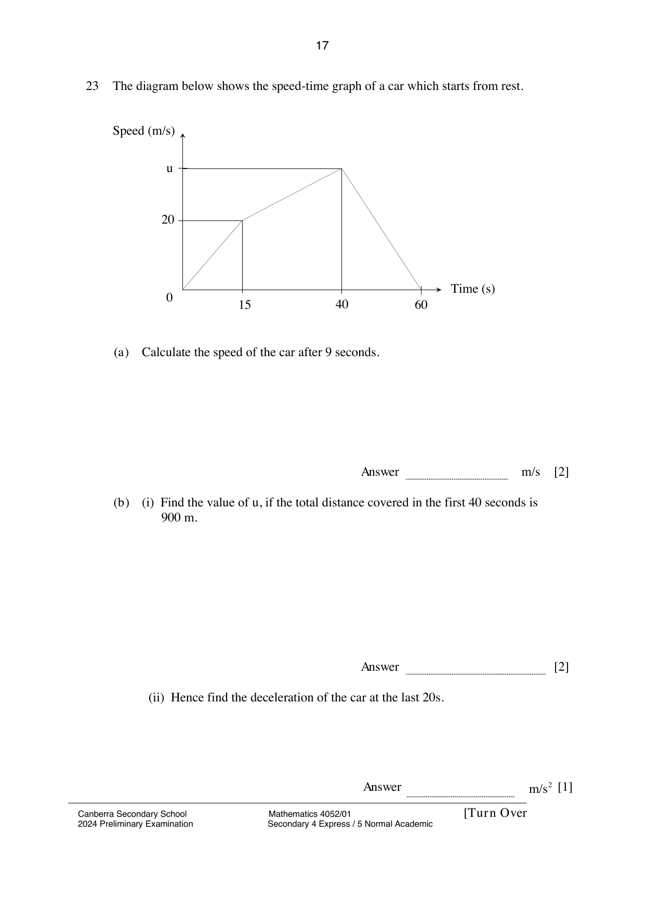

## Question

> **Marks:** (a) 2, (b)(i) 2, (b)(ii) 1; total 5
> **Page:** 17

The diagram below shows the speed-time graph of a car which starts from rest.

**(a)** Calculate the speed of the car after 9 seconds. [2]

**(b)**

**(i)** Find the value of $u$, if the total distance covered in the first 40 seconds is 900 m. [2]

**(ii)** Hence find the deceleration of the car at the last 20 s. [1]

## Answer Scheme

**(a)** Let the speed of the car after $9\text{ s}$ be $v\text{ m/s}$.

$$
\frac{v}{20} = \frac{9}{15}, \quad v = 12
$$

**(b)(i)**

$$
\left(\frac{1}{2}\times 15\times 20\right)+\frac{1}{2}(20+u)\times 25 = 900
$$

$$
\frac{1}{2}(20+u)\times 25 = 750, \quad u = 40
$$

**(b)(ii)** $2\text{ m/s}^{2}$.
