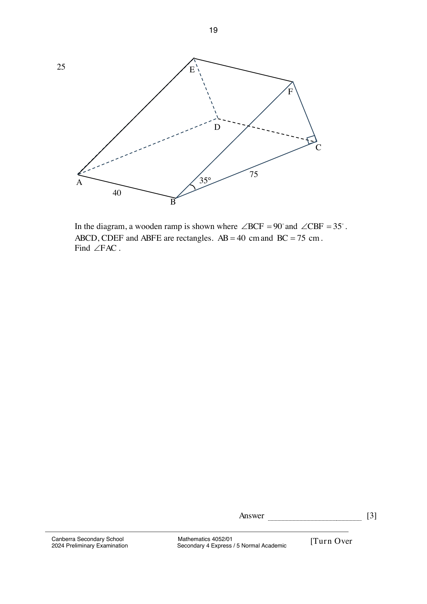

## Question

> **Marks:** 3
> **Page:** 19

In the diagram, a wooden ramp is shown where $\angle BCF = 90^{\circ}$ and $\angle CBF = 35^{\circ}$.
$ABCD$, $CDEF$ and $ABFE$ are rectangles. $AB = 40\text{ cm}$ and $BC = 75\text{ cm}$.
Find $\angle FAC$. [3]

## Answer Scheme

$$
\tan 35^{\circ} = \frac{FC}{75}, \quad FC = 75\tan 35^{\circ}
$$

$$
AC = \sqrt{40^{2}+75^{2}} = \sqrt{7225}
$$

$$
\tan\angle FAC = \frac{FC}{AC} = \frac{75\tan 35^{\circ}}{\sqrt{7225}}
$$

$$
\angle FAC = \tan^{-1}\left(\frac{75\tan 35^{\circ}}{\sqrt{7225}}\right) = 31.70902^{\circ} \approx 31.7^{\circ}
$$
