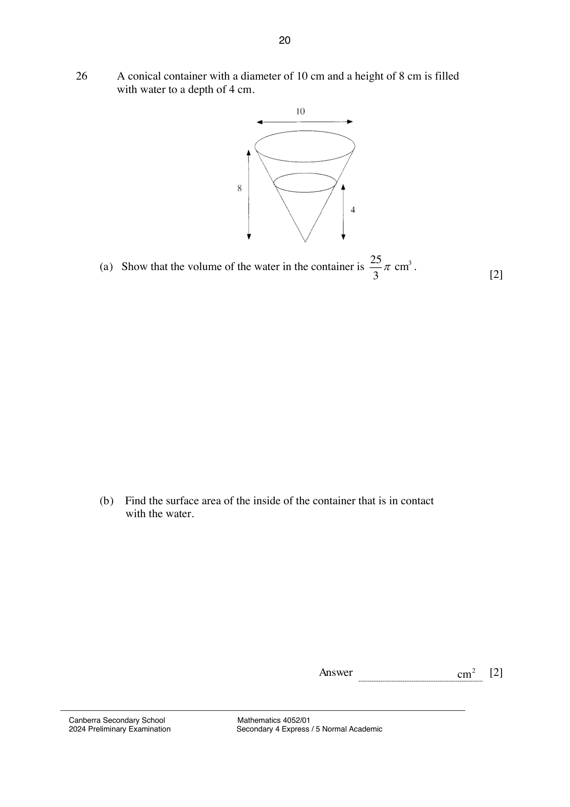

## Question

> **Marks:** (a) 2, (b) 2, (c) 3; total 7
> **Page:** 20–21

A conical container with a diameter of 10 cm and a height of 8 cm is filled with water to a depth of 4 cm.

**(a)** Show that the volume of the water in the container is $\dfrac{25}{3}\pi\text{ cm}^{3}$. [2]

**(b)** Find the surface area of the inside of the container that is in contact with the water. [2]

**(c)** The water in the cone is poured into a test tube.
The test tube is made by joining together a cylinder of diameter 3 cm and a hemisphere of diameter 3 cm.
Calculate the height of the water in the test tube. [3]

## Answer Scheme

**(a)** Let the radius of the water surface be $r\text{ cm}$.

$$
\frac{r}{5} = \frac{4}{8}, \quad r = \frac{5}{2}
$$

$$
\text{Volume of water} = \frac{1}{3}\pi\left(\frac{5}{2}\right)^{2}\times 4 = \frac{25}{3}\pi \text{ (Shown)}
$$

**(b)** Surface area $= \pi rl$

$$
= \pi\left(\frac{5}{2}\right)\sqrt{4^{2}+\left(\frac{5}{2}\right)^{2}} = 37.04716\text{ cm}^{2} \approx 37.0\text{ cm}^{2}
$$

**(c)** Let the height of the water above the hemisphere be $h\text{ cm}$.

$$
\pi\left(\frac{3}{2}\right)^{2}h+\frac{2}{3}\pi\left(\frac{3}{2}\right)^{3} = \frac{25}{3}\pi
$$

$$
\frac{9}{4}h = \frac{73}{12}, \quad h = 2\frac{19}{27}\text{ cm}
$$

Height of water in the test-tube

$$
= \left(2\frac{19}{27}+\frac{3}{2}\right)\text{ cm} = 4\frac{11}{54}\text{ cm (or }4.20\text{ cm)}
$$
