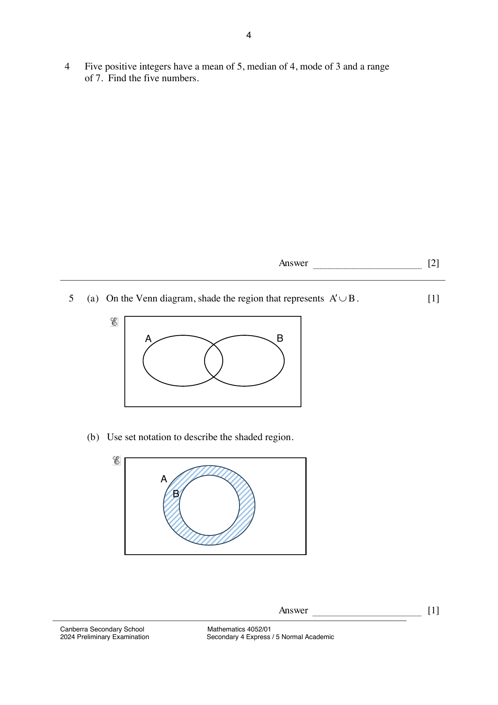

## Question

> **Marks:** (a) 1, (b) 1; total 2
> **Page:** 4

**(a)** On the Venn diagram, shade the region that represents $A' \cup B$. [1]

**(b)** Use set notation to describe the shaded region. [1]

## Answer Scheme

**(a)** The rectangle outside $A \cup B$ is shaded, circle $A$ (excluding $A \cap B$) is unshaded, and circle $B$ including $A \cap B$ is shaded.

**(b)** $A \cap B'$.
