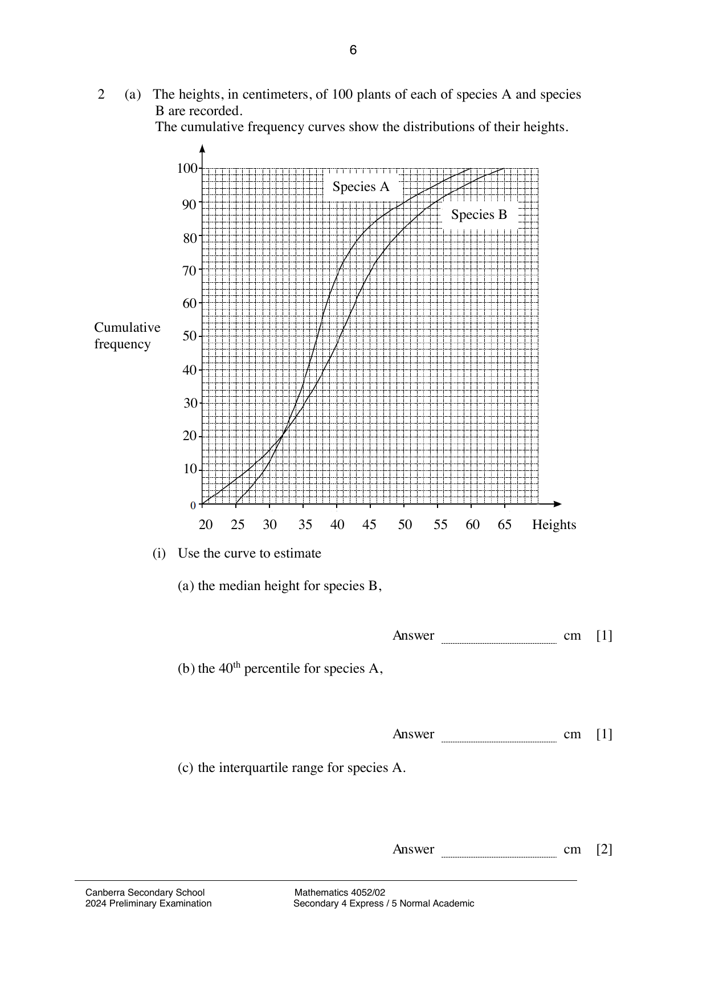

## Question

> **Marks:** (a) 6, (b) 4; total 10
> **Page:** 6–7

**(a)** The heights, in centimeters, of 100 plants of each of species A and species B are recorded.
The cumulative frequency curves show the distributions of their heights.

**(i)** Use the curve to estimate

**(a)** the median height for species B, [1]

**(b)** the 40th percentile for species A, [1]

**(c)** the interquartile range for species A. [2]

**(ii)** Plants from species B are used for an event.
Only plants with height within 10% of 50 cm are used.
Find the percentage of plants from species B which are used. [2]

**(b)** A box has 20 pots of plants.
There are 5 pink pots, 9 blue pots and the remaining pots are green.

**(i)** Two pots are taken from the box at random, without replacement.
Find, as a fraction in its simplest form, the probability that one pot is pink and the other is blue. [2]

**(ii)** These two pots are returned to the box.
Three pots are taken from the box at random, without replacement.
Find, as a fraction in its simplest form, the probability that only one pot is green. [2]

## Answer Scheme

**(a)(i)** (a) $40.5$. (b) $35.5$. (c) $42-33 = 9$.

**(a)(ii)**

$$
\frac{90-69}{100}\times 100\% = 21\%
$$

**(b)(i)**

$$
\left(\frac{5}{20}\times\frac{9}{19}\right)+\left(\frac{9}{20}\times\frac{5}{19}\right) = \frac{9}{38}
$$

**(b)(ii)**

$$
\left(\frac{6}{20}\times\frac{14}{19}\times\frac{13}{18}\right)+\left(\frac{14}{20}\times\frac{6}{19}\times\frac{13}{18}\right)+\left(\frac{14}{20}\times\frac{13}{19}\times\frac{6}{18}\right) = \frac{91}{190}
$$
