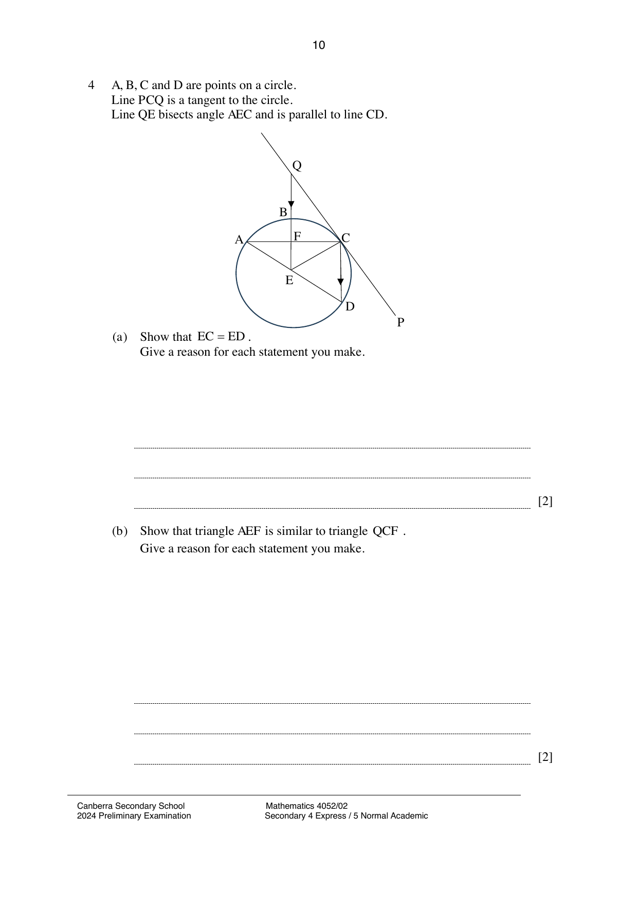

## Question

> **Marks:** (a) 2, (b) 2, (c) 4; total 8
> **Page:** 10–11

$A$, $B$, $C$ and $D$ are points on a circle.
Line $PCQ$ is a tangent to the circle.
Line $QE$ bisects angle $AEC$ and is parallel to line $CD$.

**(a)** Show that $EC = ED$.
Give a reason for each statement you make. [2]

**(b)** Show that triangle $AEF$ is similar to triangle $QCF$.
Give a reason for each statement you make. [2]

**(c)** Diameter $AD = 28\text{ cm}$ and angle $QCF = 61^{\circ}$.
Calculate the area of segment $CD$. [4]

## Answer Scheme

**(a)** Let $\angle QEC = \theta$.

$\angle QEC = \angle ECD = \theta$ (alternate angles are equal).

$\angle AEF = \angle QEC = \theta$ (angle bisector).

$\angle CED = 180^{\circ}-2\theta$ (sum of angles on a straight line).

$\angle EDC = 180^{\circ}-(180^{\circ}-2\theta)-\theta = \theta$ (sum of angles in a triangle).

Since $\angle ECD = \angle EDC$, $EC = ED$.

**(b)** $\angle AFE = \angle QFC$ (vertically opposite angles are equal).

$\angle ECF = 90^{\circ}-\theta$ (angle in a semi-circle).

$\angle FCQ = 90^{\circ}-(90^{\circ}-\theta) = \theta$ (tangent perpendicular to radius).

$\angle AEF = \angle FCQ = \theta$.

Triangles $AEF$ and $QCF$ are similar (AA).

**(c)** $\angle CED = 360^{\circ}-2(61^{\circ})-180^{\circ} = 58^{\circ}$.

$$
\text{Area of sector } ECD = \frac{58}{360}\times\pi(14)^{2} = 99.20451468
$$

$$
\text{Area of triangle } ECD = \frac{1}{2}(14)^{2}\sin 58^{\circ} = 83.10871342
$$

Area of segment $CD = 99.20451468-83.10871342 = 16.0958 \approx 16.1$.
