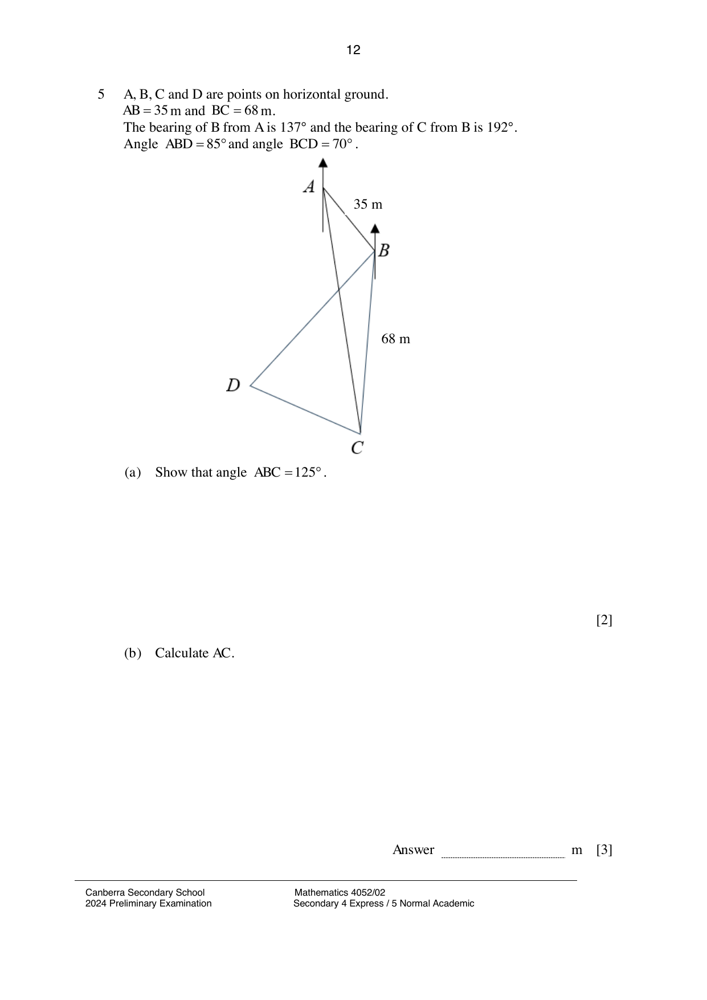

## Question

> **Marks:** (a) 2, (b) 3, (c) 2, (d) 2, (e) 3; total 12
> **Page:** 12–13

$A$, $B$, $C$ and $D$ are points on horizontal ground.
$AB = 35\text{ m}$ and $BC = 68\text{ m}$.
The bearing of $B$ from $A$ is $137^{\circ}$ and the bearing of $C$ from $B$ is $192^{\circ}$.
Angle $ABD = 85^{\circ}$ and angle $BCD = 70^{\circ}$.

**(a)** Show that angle $ABC = 125^{\circ}$. [2]

**(b)** Calculate $AC$. [3]

**(c)** Calculate $DC$. [2]

A man travels in a straight line from $D$ to $C$.
$X$ is the position of the man where it is the shortest distance from $B$ during this journey.

**(d)** Show that $BX = 63.9\text{ m}$. [2]

**(e)** A drone is hovering vertically above $B$.
The angle of elevation of the drone from $C$ is $40.5^{\circ}$.
Calculate the greatest angle of elevation of the drone from a point on $DC$. [3]

## Answer Scheme

**(a)** $192-180 = 12$. $\angle ABC = 137-12 = 125$ (shown).

**(b)**

$$
AC^{2} = 35^{2}+68^{2}-2(35)(68)\cos 125^{\circ} = 8579.223037
$$

$$
AC = 92.62409966 \approx 92.6
$$

**(c)** $\angle DBC = 125^{\circ}-85^{\circ} = 40^{\circ}$. $\angle BDC = 180^{\circ}-40^{\circ}-70^{\circ} = 70^{\circ}$.

$$
\frac{DC}{\sin 40^{\circ}} = \frac{68}{\sin 70^{\circ}}, \quad DC = 46.5147 \approx 46.5
$$

**(d)**

$$
\text{Area of triangle} = \frac{1}{2}(68)^{2}\sin 40^{\circ} = 1486.124954
$$

$$
1486.124954 = \frac{1}{2}\times 46.5147\times h, \quad h = 63.89915247 \approx 63.9
$$

**(e)**

$$
\tan 40.5^{\circ} = \frac{h}{68}, \quad h = 58.07748661
$$

$$
\tan\theta = \frac{58.07748661}{63.89915247}, \quad \theta = 42.3^{\circ}
$$
