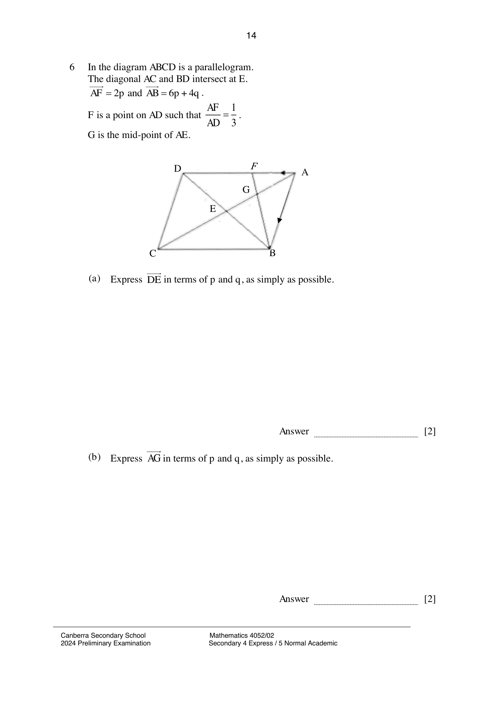

## Question

> **Marks:** (a) 2, (b) 2, (c) 2, (d) 2, (e) 2; total 10
> **Page:** 14–15

In the diagram $ABCD$ is a parallelogram.
The diagonal $AC$ and $BD$ intersect at $E$.
$\overrightarrow{AF} = 2\mathbf{p}$ and $\overrightarrow{AB} = 6\mathbf{p}+4\mathbf{q}$.
$F$ is a point on $AD$ such that $\dfrac{AF}{AD} = \dfrac{1}{3}$.
$G$ is the mid-point of $AE$.

**(a)** Express $\overrightarrow{DE}$ in terms of $\mathbf{p}$ and $\mathbf{q}$, as simply as possible. [2]

**(b)** Express $\overrightarrow{AG}$ in terms of $\mathbf{p}$ and $\mathbf{q}$, as simply as possible. [2]

**(c)** Show that $\overrightarrow{BG} = -3\mathbf{p}-3\mathbf{q}$. [2]

**(d)** Explain why $B$, $G$ and $F$ lie on a straight line. [2]

**(e)** Calculate $\dfrac{\text{the area of triangle } ABF}{\text{the area of parellogram } ABCD}$. [2]

## Answer Scheme

**(a)** $\overrightarrow{AD} = 6\mathbf{p}$.

$\overrightarrow{DB} = \overrightarrow{DA}+\overrightarrow{AB} = -6\mathbf{p}+6\mathbf{p}+4\mathbf{q} = 4\mathbf{q}$.

$\overrightarrow{DE} = 2\mathbf{q}$.

**(b)** $\overrightarrow{AE} = \overrightarrow{AD}+\overrightarrow{DE} = 6\mathbf{p}+2\mathbf{q}$.

$\overrightarrow{AG} = 3\mathbf{p}+\mathbf{q}$.

**(c)** $\overrightarrow{BG} = \overrightarrow{BA}+\overrightarrow{AG} = -6\mathbf{p}-4\mathbf{q}+3\mathbf{p}+\mathbf{q} = -3\mathbf{p}-3\mathbf{q}$.

**(d)** $\overrightarrow{GF} = \overrightarrow{GA}+\overrightarrow{AF} = -3\mathbf{p}-\mathbf{q}+2\mathbf{p} = -\mathbf{p}-\mathbf{q}$.

$\overrightarrow{BG} = 3\overrightarrow{GF}$.

$\overrightarrow{BG}$ is parallel to $\overrightarrow{GF}$ and there is a common point $G$; therefore $B$, $G$ and $F$ lie on a straight line.

**(e)**

$$
\frac{\text{the area of triangle } ABF}{\text{the area of triangle } ABD} = \frac{1}{3}
$$

$$
\frac{\text{the area of triangle } ABD}{\text{the area of parellogram } ABCD} = \frac{1}{2} = \frac{3}{6}
$$

$$
\frac{\text{the area of triangle } ABF}{\text{the area of parellogram } ABCD} = \frac{1}{6}
$$
