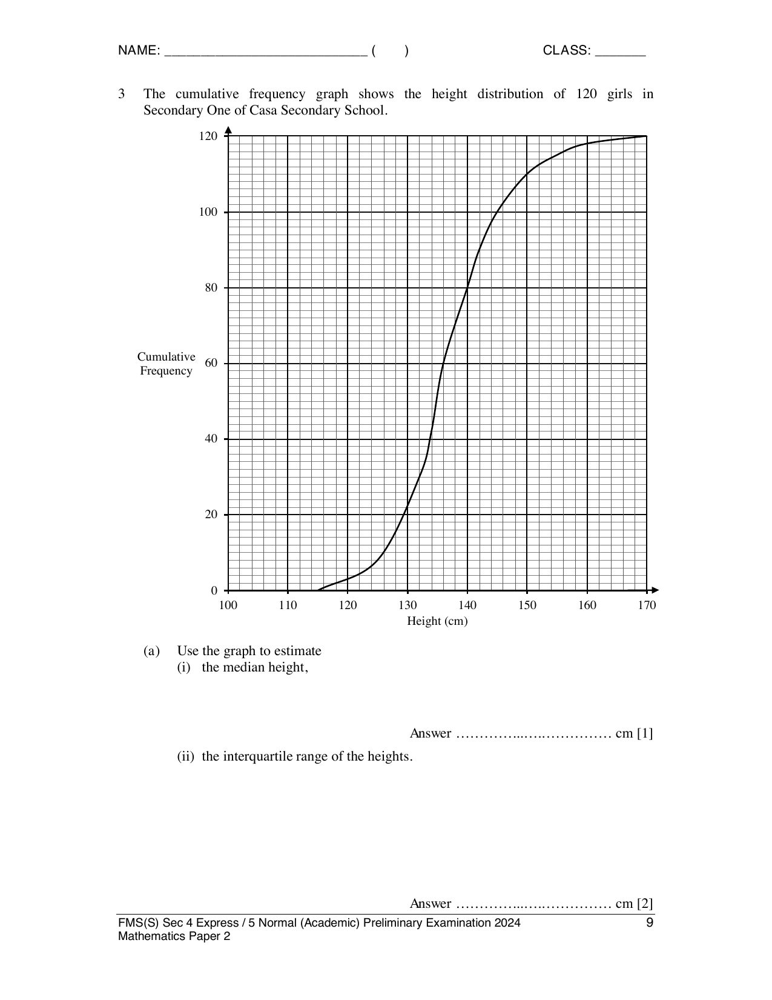

## Question

> **Marks:** (a)(i) 1, (a)(ii) 2, (b) 2, (c) 2, (d)(i) 1, (d)(ii) 2; total 10
> **Page:** 9–11

The cumulative frequency graph shows the height distribution of 120 girls in Secondary One of Casa Secondary School.

**(a)** Use the graph to estimate

**(i)** the median height, [1]

**(ii)** the interquartile range of the heights. [2]

**(b)** For a girl to be selected to join the school’s volleyball team, she must be of at least 160 cm in height. Estimate the percentage of the girls who meet the above criteria. [2]

**(c)** The heights of 120 girls in Secondary One from Landmark Secondary School were recorded. The median height is 140 cm and the interquartile range of the height is 13 cm. Make two comparisons between the height distribution in Casa Secondary School and Landmark Secondary School. [2]

**(d)** The table summarises the amount of weekly allowance in a class.

| Allowance, $x$ (＄) | $15 \leq x < 20$ | $20 \leq x < 25$ | $25 \leq x < 30$ | $30 \leq x < 35$ | $35 \leq x < 40$ |
| --- | --- | --- | --- | --- | --- |
| Number of students | 5 | 13 | 15 | 6 | 6 |

Two of the students were selected at random. Find, as a fraction in its simplest form, the probability that

**(i)** they both had weekly allowance that is less than ＄25, [1]

**(ii)** one had at least ＄30 of weekly allowance and the other had less than ＄20 of weekly allowance. [2]

## Answer Scheme

**(a)(i)** Median $= 136\text{ cm}$. B1.

**(a)(ii)** Lower quartile $= 132$, upper quartile $= 142$, interquartile range $= 10\text{ cm}$. M1, A1.

**(b)** Number of girls $= 2$.

$$
\frac{2}{120}\times 100\% = 1.67\% \text{ (3 s.f.) or } 1\frac{2}{3}\%
$$

B2.

**(c)** Casa Secondary School girls are shorter as the median height is less than Landmark Secondary School, or vice versa. Casa has a smaller or larger spread of height as the interquartile range is less than Landmark, or vice versa. Accept “more consistent” if a smaller spread is stated. A1 must state median. A1 must state spread.

**(d)(i)**

$$
\frac{18}{45}\times\frac{17}{44} = \frac{17}{110}
$$

B1.

**(d)(ii)**

$$
\frac{12}{45}\times\frac{5}{44}+\frac{5}{45}\times\frac{12}{44} = \frac{2}{33}
$$

M1, A1.
