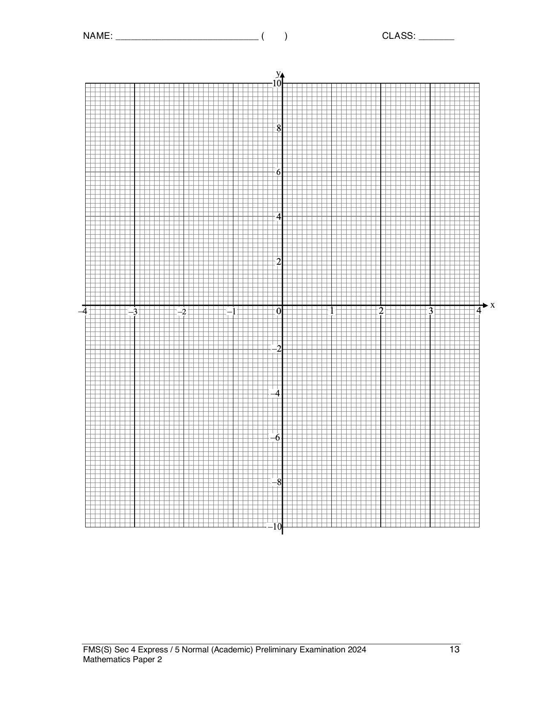

## Question

> **Marks:** (a) 1, (b) 3, (c)(i) 2, (c)(ii) 2, (c)(iii) 3; total 11
> **Page:** 12–13

The table below shows some values of $x$ and corresponding values of $y$ for $y = \dfrac{6}{x^{2}}-\dfrac{3}{2}x-6$.

**(a)** Complete the table of values, giving your answer correct to 1 decimal place. [1]

| $x$ | $-3$ | $-2$ | $-1$ | $-0.7$ | $0.6$ | $1$ | $2$ | $3$ |
| --- | --- | --- | --- | --- | --- | --- | --- | --- |
| $y$ | $-0.8$ |  | $1.5$ | $7.3$ | $9.8$ | $-1.5$ | $-7.5$ | $-9.8$ |

**(b)** On the grid, draw the graph of $y = \dfrac{6}{x^{2}}-\dfrac{3}{2}x-6$ for $-3 \leq x \leq 3$. [3]

**(c)(i)** On the same grid, draw the graph of $2y-5x = 10$ for $-3 \leq x \leq 2$. [2]

**(ii)** Write down the $x$-coordinates of the points where the line intersects the curve. [2]

**(iii)** These values of $x$ are solutions to the equation $4x^{3}+Ax^{2}+B = 0$. Find the value of $A$ and the value of $B$. [3]

## Answer Scheme

**(a)** When $x = -2$, $y = -1.5$ (1 d.p.). B1.

**(b)** See the scheme graph. P2 if all points are plotted correctly, P1 for 7 points, otherwise P0. Curve C1.

**(c)(i)** Line on the same graph. P1, L1.

**(c)(ii)** $x = -2.45\pm 0.2$, $-0.85\pm 0.1$, $0.65\pm 0.1$. B2 for all, B1 for 2 correct.

**(c)(iii)**

$$
2\left(\frac{6}{x^{2}}-\frac{3}{2}x-6\right)-5x = 10
$$

$$
4x^{3}+11x^{2}-6 = 0
$$

$A = 11$, $B = -6$. M1, B1, B1.
