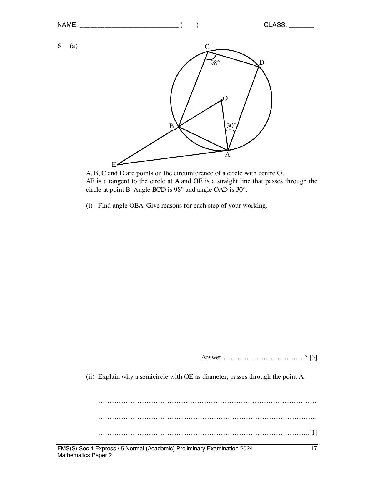
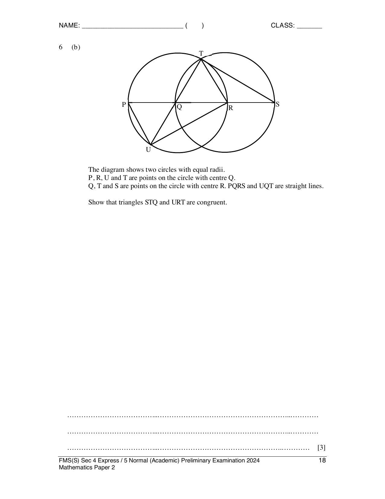

## Question

> **Marks:** (a)(i) 3, (a)(ii) 1, (b) 3; total 7
> **Page:** 17–18

**(a)**

$A$, $B$, $C$ and $D$ are points on the circumference of a circle with centre $O$. $AE$ is a tangent to the circle at $A$ and $OE$ is a straight line that passes through the circle at point $B$. $\angle BCD = 98^{\circ}$ and $\angle OAD = 30^{\circ}$.

**(i)** Find $\angle OEA$. Give reasons for each step of your working. [3]

**(ii)** Explain why a semicircle with $OE$ as diameter passes through the point $A$. [1]

**(b)**

The diagram shows two circles with equal radii. $P$, $R$, $U$ and $T$ are points on the circle with centre $Q$. $Q$, $T$ and $S$ are points on the circle with centre $R$. $PQRS$ and $UQT$ are straight lines.

Show that triangles $STQ$ and $URT$ are congruent. [3]

## Answer Scheme

**(a)(i)** $\angle BAD = 180^{\circ}-98^{\circ} = 82^{\circ}$ (angles in opposite segments).

$\angle BAO = 82^{\circ}-30^{\circ} = 52^{\circ}$.

$\angle BOA = 180^{\circ}-2(52^{\circ}) = 76^{\circ}$ (angle sum of an isosceles triangle).

$\angle OAE = 90^{\circ}$ (tangent perpendicular to radius).

$\angle OEA = 180^{\circ}-90^{\circ}-76^{\circ} = 14^{\circ}$. B1, B1, B1. Minus 1 mark if no or a wrong reason is given.

**(a)(ii)** Since $\angle OAE = 90^{\circ}$ (tangent perpendicular to radius), a right angle is formed in a semicircle, so a circle with diameter $OE$ passes through $A$. AG1.

**(b)** One acceptable proof: $\angle QTS = \angle TRU$ (right angle in a semicircle), $QS = TU$ (diameters of two equal circles), $QT = TR$ (radii of two equal circles). By RHS, triangles $STQ$ and $URT$ are congruent. M2 for RHS, AG1. Minus 1 if no or a wrong reason is given. ASA and AAS alternatives are also on the scheme.
