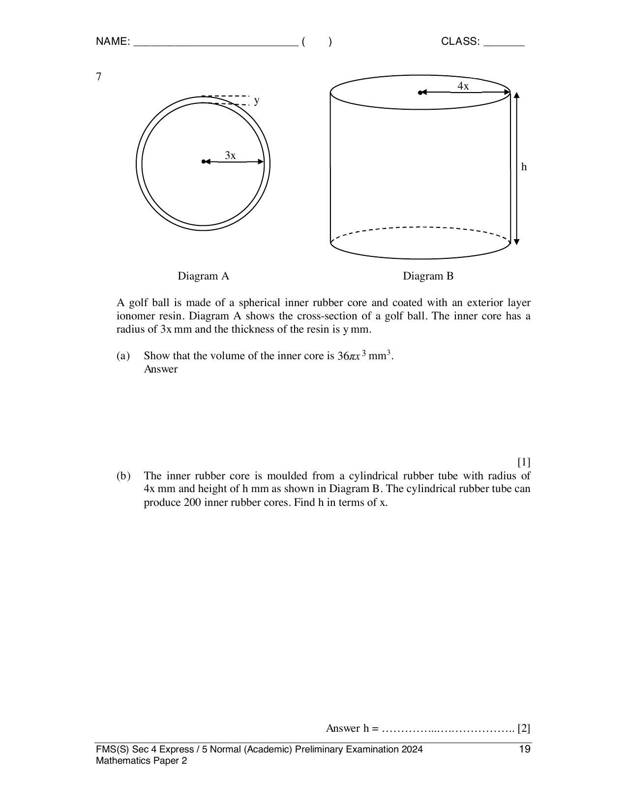

## Question

> **Marks:** (a) 1, (b) 2, (c) 2, (d) 4; total 9
> **Page:** 19–20

A golf ball is made of a spherical inner rubber core and coated with an exterior layer of ionomer resin. Diagram A shows the cross-section of a golf ball. The inner core has a radius of $3x\text{ mm}$ and the thickness of the resin is $y\text{ mm}$.

**(a)** Show that the volume of the inner core is $36\pi x^{3}\text{ mm}^{3}$. [1]

**(b)** The inner rubber core is moulded from a cylindrical rubber tube with radius of $4x\text{ mm}$ and height of $h\text{ mm}$ as shown in Diagram B. The cylindrical rubber tube can produce 200 inner rubber cores. Find $h$ in terms of $x$. [2]

**(c)** The volume of the cylindrical rubber tube is $2024363\pi\text{ mm}^{3}$. Calculate the value of $x$. [2]

**(d)** Each inner rubber core is coated with 1.8 mm of ionomer resin. The golf ball is then wrapped round with a plastic sheet. Given that the dimensions of the plastic sheet are 62 cm by 92 cm, calculate the number of golf balls that can be wrapped from this plastic sheet. [4]

## Answer Scheme

**(a)**

$$
\frac{4}{3}\pi(3x)^{3} = 36\pi x^{3} \text{ (shown)}
$$

AG1.

**(b)** $\pi(4x)^{2}h = 200\times 36\pi x^{3}$, so $h = 450x$. M1, A1.

**(c)**

$$
16\pi(450)x^{2} = 2024363\pi, \quad x = \sqrt[3]{\frac{2024363}{16\times 450}} = 6.55 \text{ (3 s.f.)}
$$

M1, A1.

**(d)** Radius $= 3x+1.8 = 21.4534\text{ mm}$. Surface area $= 4\pi(21.4534)^{2} = 5783.6516\text{ mm}^{2}$.

$$
\frac{620\times 920}{5783.6516} = 98.622
$$

98 golf balls (round down). B1, M1, M1, A1.
