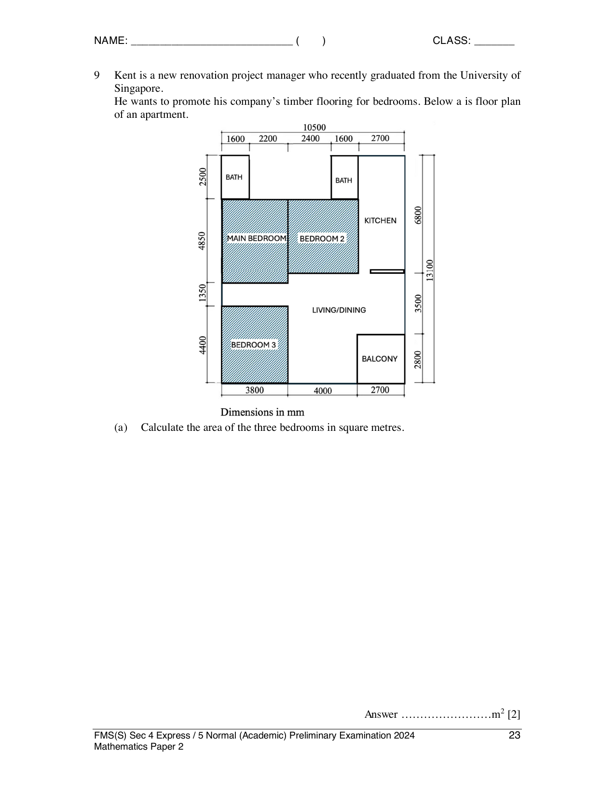

## Question

> **Marks:** (a) 2, (b) 1, (c) 7; total 10
> **Page:** 23–26

Kent is a new renovation project manager. He wants to promote his company’s timber flooring for bedrooms.

**(a)** Calculate the area of the three bedrooms in square metres. [2]

**(b)** A cement screed of 0.05 m thickness is needed in each bedroom before the timber planks can be laid on top. Calculate the total volume of cement screed, in cubic metres, needed for the three bedrooms. [1]

**(c)** Kent’s colleague also gives him this information.

| Item | Description | Unit cost |
| --- | --- | --- |
| Pre-mixed cement-sand mixture (local) | Bag of 40 kg, bulk (1–49 bags) | ＄20.00 |
|  | Bulk (50–99 bags) | ＄18.50 |
|  | Bulk (100+ bags) | ＄16.50 |
| Timber planks (Vietnam) | 6 cm by 30 cm, 50 planks per box | ＄35.50 |

1400 kg of cement-sand mixture produce up to 1 cubic metre of cement screed. Timber planks are fitted so that the number of planks needed depends on the floor area and not on the orientation of the planks.

| Type | Description | Unit cost |
| --- | --- | --- |
| General worker | Mixing/pouring cement screed and finishing surface | ＄5 per hour |
| Skilled worker | Installation, polishing and repair of timber flooring | ＄10 per hour |

A worker is only allowed to work for 8 hours per day.

| Item | Number of workers required | Number of days to complete |
| --- | --- | --- |
| Cement screed construction | 4 | 1 |
| Timber flooring installation | 2 | 3 |

$1$ square foot $= 0.09203$ square metres.

Kent needs to decide how much he should charge his customers for the timber flooring installation for three bedrooms. He must make sure that he charges enough money to cover all his costs. Suggest a sensible amount in price per square foot to charge his customers. Justify the decision you made and show your calculations clearly. [7]

## Answer Scheme

**(a)** Area of the three bedrooms $= 52.35\text{ m}^{2}$. One method on the scheme uses millimetre dimensions from the plan: $3800\times 4850+(2400+1600)(6800-2500)+3800\times 4400 = 52350000\text{ mm}^{2}$. M1, A1.

**(b)** Volume $= 52.35\times 0.05 = 2.6175\text{ m}^{3}$. B1.

**(c)** Cement-sand mixture $= 2.6175\times 1400 = 3664.5\text{ kg}$. Bags $= 3664.5\div 40 = 92$ (round up). Cost $= 92\times 18.50 = 1702$.

Planks $= 52.35\div(0.06\times 0.3) = 2909$ (round up). Boxes $= 59$ (round up). Cost $= 59\times 35.50 = 2094.50$.

Manpower: cement screed $= 4\times 1\times 8\times 5 = 160$. Timber $= 2\times 3\times 8\times 10 = 480$. Total manpower $= 640$.

Total cost $= 1702+2094.50+640 = 4436.50$.

Floor size $= 52.35\div 0.09203 = 568.836$ square feet. Cost per square foot $= 7.80$.

Kent should charge ＄10 per square foot (any amount more than the total cost).
