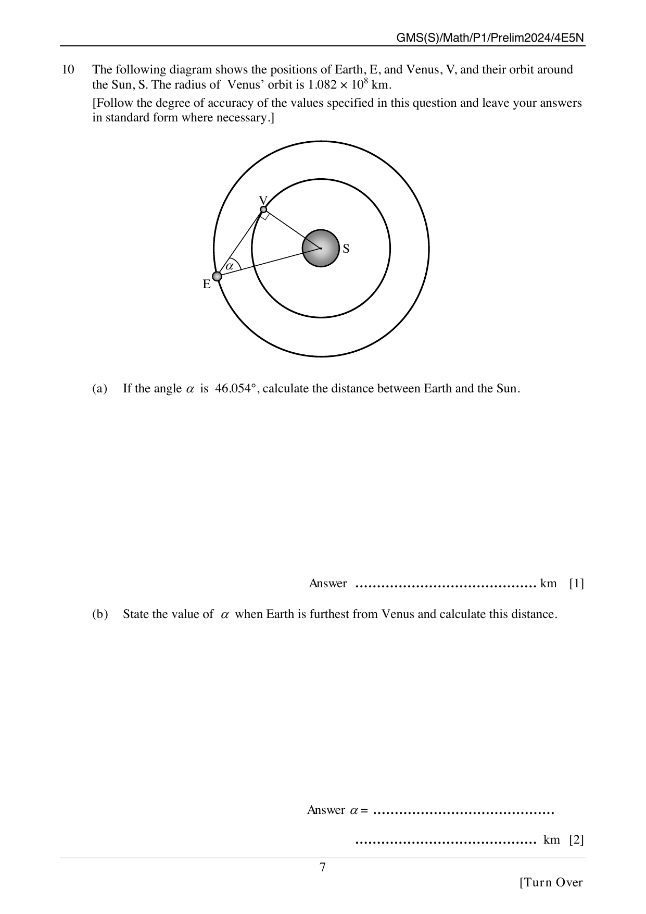

## Question

> **Marks:** 3
> **Page:** 7

The following diagram shows the positions of Earth, $E$, and Venus, $V$, and their orbit around the Sun, $S$. The radius of Venus' orbit is $1.082 \times 10^{8}$ km.

[Follow the degree of accuracy of the values specified in this question and leave your answers in standard form where necessary.]

$S$ is the centre. $V$ lies on the inner orbit and $E$ on the outer orbit. $SV$ and $SE$ are drawn, and the angle at $E$ between $ES$ and the chord $EV$ is $\alpha$. The angle at $V$ in triangle $EVS$ is a right angle.

(a) If the angle $\alpha$ is $46.054^{\circ}$, calculate the distance between Earth and the Sun. [1]

(b) State the value of $\alpha$ when Earth is furthest from Venus and calculate this distance. [2]

## Answer Scheme

(a) $\sin 46.054^{\circ} = \dfrac{1.082\times 10^{8}}{ES}$, so

$ES = \dfrac{1.082\times 10^{8}}{\sin 46.054^{\circ}} = 1.503\times 10^{8}$ km (3 d.p. in standard form, matching the given data). [1]

(b) Earth is furthest from Venus when $\alpha = 0.000^{\circ}$ ($ES$ and $VS$ collinear). Distance $= ES+VS = 2.585\times 10^{8}$ km. [2]
