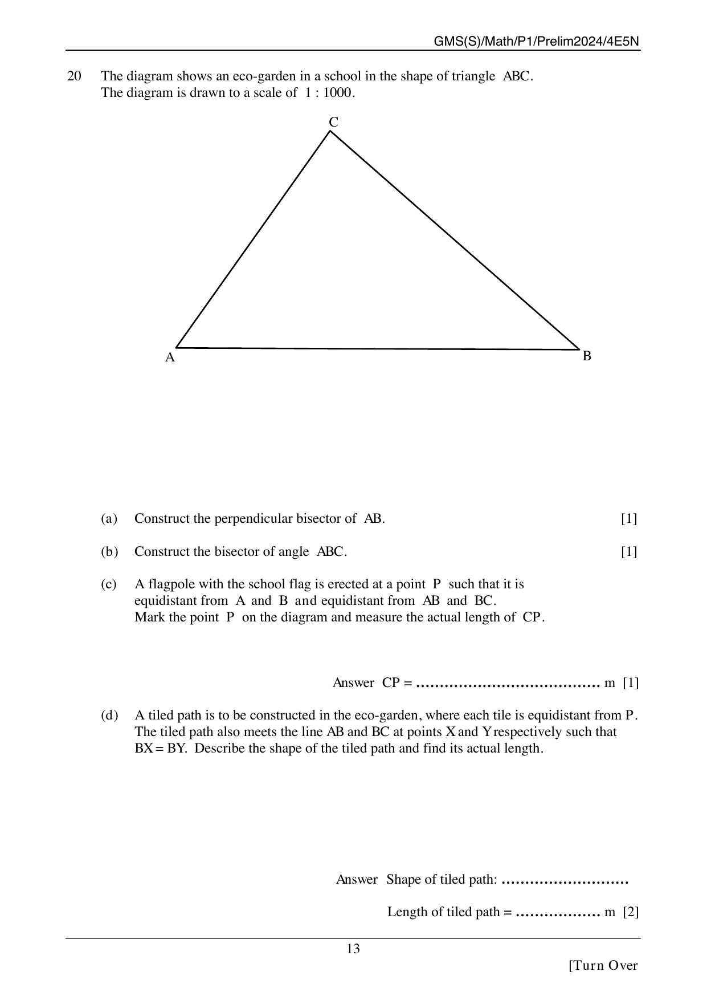
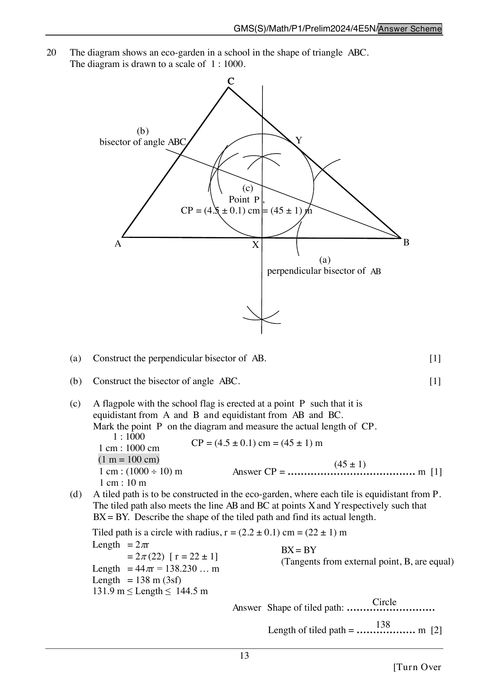

## Question

> **Marks:** 5
> **Page:** 13

The diagram shows an eco-garden in a school in the shape of triangle $ABC$. The diagram is drawn to a scale of $1:1000$.

$AB$ is the horizontal base, with $A$ on the left and $B$ on the right. $C$ is above the base, closer to $A$ than to $B$.

(a) Construct the perpendicular bisector of $AB$. [1]

(b) Construct the bisector of angle $ABC$. [1]

(c) A flagpole with the school flag is erected at a point $P$ such that it is equidistant from $A$ and $B$ and equidistant from $AB$ and $BC$. Mark the point $P$ on the diagram and measure the actual length of $CP$. [1]

(d) A tiled path is to be constructed in the eco-garden, where each tile is equidistant from $P$. The tiled path also meets the line $AB$ and $BC$ at points $X$ and $Y$ respectively such that $BX = BY$. Describe the shape of the tiled path and find its actual length. [2]

## Answer Scheme

Scale: $1$ cm on the diagram represents $10$ m.

(a) Perpendicular bisector of $AB$. [1]

(b) Bisector of angle $ABC$. [1]

(c) $P$ is the intersection of those two loci. $CP = (4.5\pm 0.1)$ cm $= (45\pm 1)$ m. [1]

(d) The tiled path is a circle (tangents from the external point $B$ are equal, so the circle centre $P$ meets $AB$ and $BC$ with $BX = BY$). Radius $r = (2.2\pm 0.1)$ cm $= (22\pm 1)$ m. Length $= 2\pi r = 2\pi(22) = 138$ m (3 s.f.). Accept $131.9\text{ m} \leq \text{length} \leq 144.5\text{ m}$. [2]
