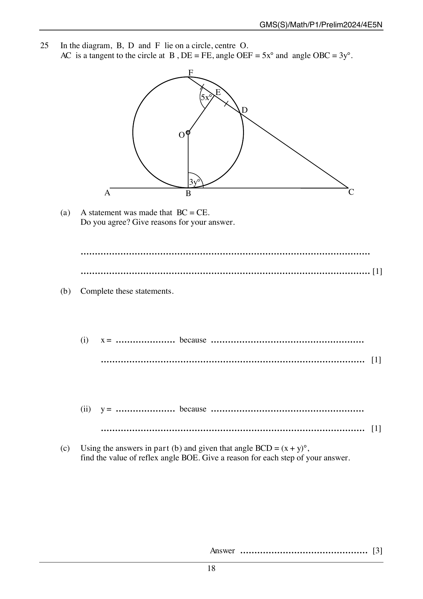

## Question

> **Marks:** 6
> **Page:** 18

In the diagram, $B$, $D$ and $F$ lie on a circle, centre $O$. $AC$ is a tangent to the circle at $B$, $DE = FE$, angle $OEF = 5x^{\circ}$ and angle $OBC = 3y^{\circ}$.

$AC$ is a horizontal tangent with $A$ to the left of the point of contact $B$ and $C$ to the right. $O$ is above $B$, so $OB$ is vertical. $F$ is the top of the circle. A straight line from $C$ meets the circle at $D$ and passes through $E$ outside the circle, with $DE = FE$ marked. Angle $OEF = 5x^{\circ}$ and angle $OBC = 3y^{\circ}$.

(a) A statement was made that $BC = CE$. Do you agree? Give reasons for your answer. [1]

(b) Complete these statements.

(i) $x = \ldots\ldots\ldots$ because $\ldots\ldots\ldots$ [1]

(ii) $y = \ldots\ldots\ldots$ because $\ldots\ldots\ldots$ [1]

(c) Using the answers in part (b) and given that angle $BCD = (x+y)^{\circ}$, find the value of reflex angle $BOE$. Give a reason for each step of your answer. [3]

## Answer Scheme

(a) Disagree. $AC$ is a tangent at $B$, but the line through $C$, $E$ and $D$ is not a tangent at $E$ ($E$ is not on the circumference). The equal-tangents theorem therefore does not give $BC = CE$. [1]

(b) (i) $x = 18$ because $OE$ is the perpendicular bisector of chord $DF$, so angle $OEF = 90^{\circ}$ and $5x = 90$. No mark if the value is correct but the reason is not. [1]

(ii) $y = 30$ because the tangent $AC$ is perpendicular to the radius $OB$, so angle $OBC = 90^{\circ}$ and $3y = 90$. No mark if the value is correct but the reason is not. [1]

(c) Angle $BCD = (18+30)^{\circ} = 48^{\circ}$.

Obtuse angle $BOE = (360-90-90-48)^{\circ} = 132^{\circ}$ (sum of angles in the quadrilateral, using the perpendicular bisector of the chord and the tangent perpendicular to the radius).

Reflex angle $BOE = (360-132)^{\circ} = 228^{\circ}$ (angles at a point). [3]
