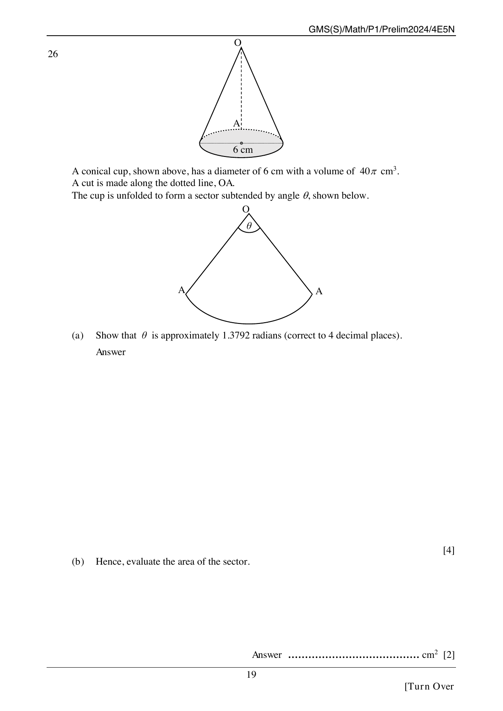

## Question

> **Marks:** 6
> **Page:** 19

A conical cup, shown above, has a diameter of $6$ cm with a volume of $40\pi\text{ cm}^{3}$. A cut is made along the dotted line, $OA$. The cup is unfolded to form a sector subtended by angle $\theta$, shown below.

The cone stands with vertex $O$ at the top and a circular base of diameter $6$ cm. The dotted line $OA$ runs from $O$ down a generator to a point $A$ on the base circumference, and a vertical dotted line runs from $O$ to the centre of the base. The net is a sector with the same vertex $O$, angle $\theta$, and both radii labelled $A$.

(a) Show that $\theta$ is approximately $1.3792$ radians (correct to $4$ decimal places). [4]

(b) Hence, evaluate the area of the sector. [2]

## Answer Scheme

(a) Base radius $r = 3$ cm.

$\dfrac{1}{3}\pi(3)^{2}h = 40\pi$, so $3h = 40$ and $h = \dfrac{40}{3}$ cm.

$OA^{2} = \left(\dfrac{40}{3}\right)^{2}+3^{2} = \dfrac{1681}{9}$, so $OA = \dfrac{41}{3}$ cm.

Arc length equals the base circumference: $\dfrac{41}{3}\theta = 2\pi(3)$, so $\theta = 6\pi\div\dfrac{41}{3} = 1.3792$ (4 d.p.). [4]

(b) Area $= \dfrac{1}{2}\left(\dfrac{41}{3}\right)^{2}(1.3792) = 129\text{ cm}^{2}$ (3 s.f.). [2]
