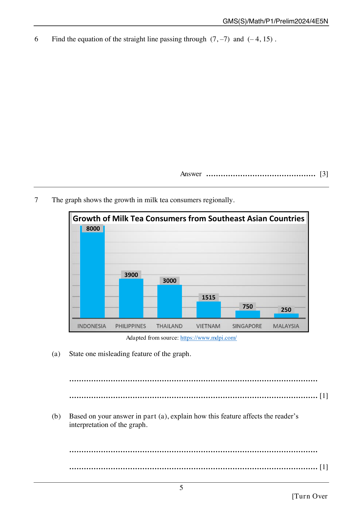

## Question

> **Marks:** 2
> **Page:** 5

The graph shows the growth in milk tea consumers regionally.

The chart is titled "Growth of Milk Tea Consumers from Southeast Asian Countries". The bars, with no labelled vertical scale, read Indonesia $8000$, Philippines $3900$, Thailand $3000$, Vietnam $1515$, Singapore $750$ and Malaysia $250$. Adapted from source: https://www.mdpi.com/

(a) State one misleading feature of the graph. [1]

(b) Based on your answer in part (a), explain how this feature affects the reader's interpretation of the graph. [1]

## Answer Scheme

(a) Any comment with a substantial and mathematically sound justification is accepted. Examples given: the values do not specify whether they are actual values or percentages; there is no $y$-axis, so the length of each bar cannot be checked against the printed value; the title says "growth", which needs a comparison that is not shown. [1]

(b) Any interpretation or conclusion with a substantial and mathematically sound justification based on the evidence in (a) is accepted. [1]
