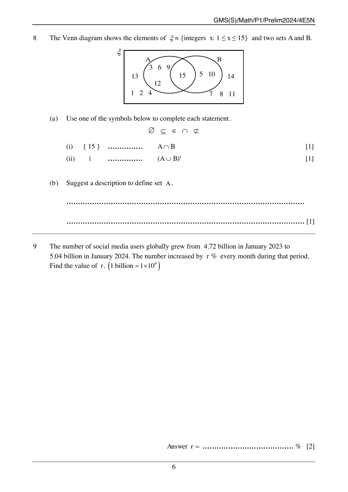

## Question

> **Marks:** 3
> **Page:** 6

The Venn diagram shows the elements of $\xi = \{\text{integers } x: 1 \leq x \leq 15\}$ and two sets $A$ and $B$.

In $A$ only: $3$, $6$, $9$, $12$. In $A \cap B$: $15$. In $B$ only: $5$, $10$. Outside both sets: $1$, $2$, $4$, $7$, $8$, $11$, $13$, $14$.

(a) Use one of the symbols below to complete each statement.

$\varnothing \quad \subseteq \quad \in \quad \cap \quad \not\subset$

(i) $\{15\}$ $\ldots\ldots\ldots$ $A \cap B$ [1]

(ii) $1$ $\ldots\ldots\ldots$ $(A \cup B)'$ [1]

(b) Suggest a description to define set $A$. [1]

## Answer Scheme

(a) (i) $\{15\} \subseteq A \cap B$. [1]

(ii) $1 \in (A \cup B)'$. [1]

(b) $A = \{\text{integer } x: x\text{ is a multiple of } 3\}$ or $x$ is divisible by $3$. [1]
