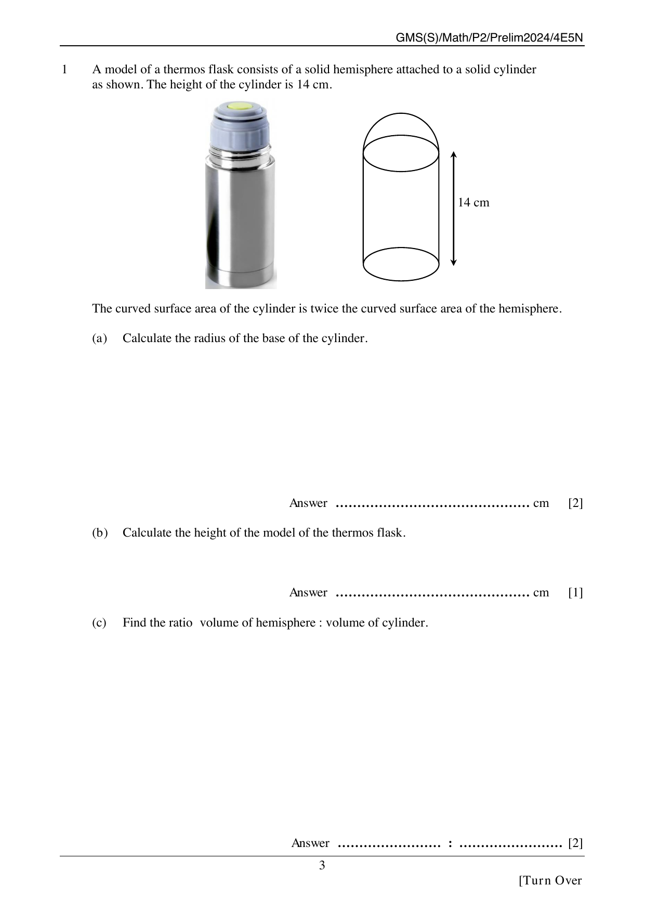

## Question

> **Marks:** 5

> **Page:** 3

A model of a thermos flask consists of a solid hemisphere attached to a solid cylinder as shown. The height of the cylinder is $14$ cm.

The curved surface area of the cylinder is twice the curved surface area of the hemisphere.

(a) Calculate the radius of the base of the cylinder. [2]

(b) Calculate the height of the model of the thermos flask. [1]

(c) Find the ratio volume of hemisphere : volume of cylinder. [2]

## Answer Scheme

(a) Curved surface area of the cylinder is twice the curved surface area of the hemisphere.

$$2\pi r h = 2(2\pi r^2)$$

$$2\pi r(14) = 4\pi r^2$$

$$r = 7 \text{ cm}$$

(b) Height of the model $= 14 + 7 = 21$ cm.

(c)

$$\frac{2}{3}\pi r^3 : \pi r^2 h = \frac{2}{3}\pi(7)^3 : \pi(7)^2(14) = 2 : 6 = 1 : 3$$
