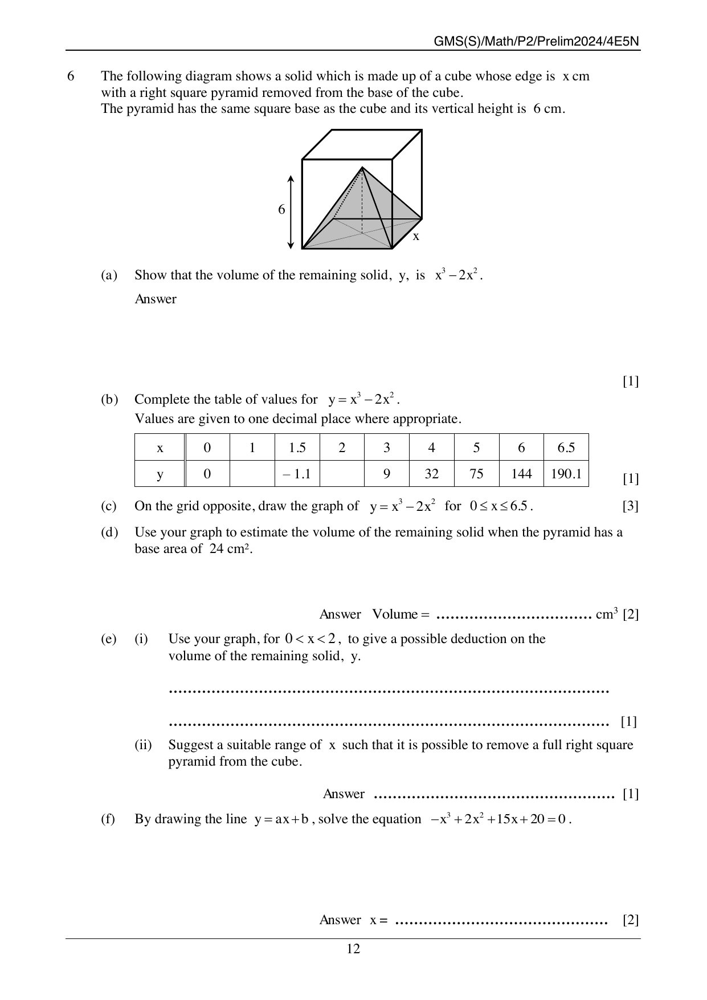
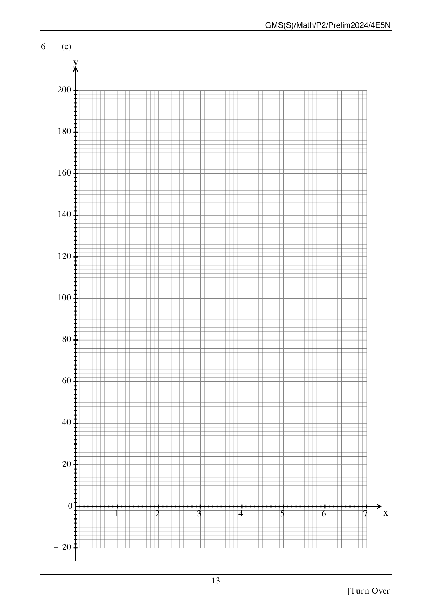
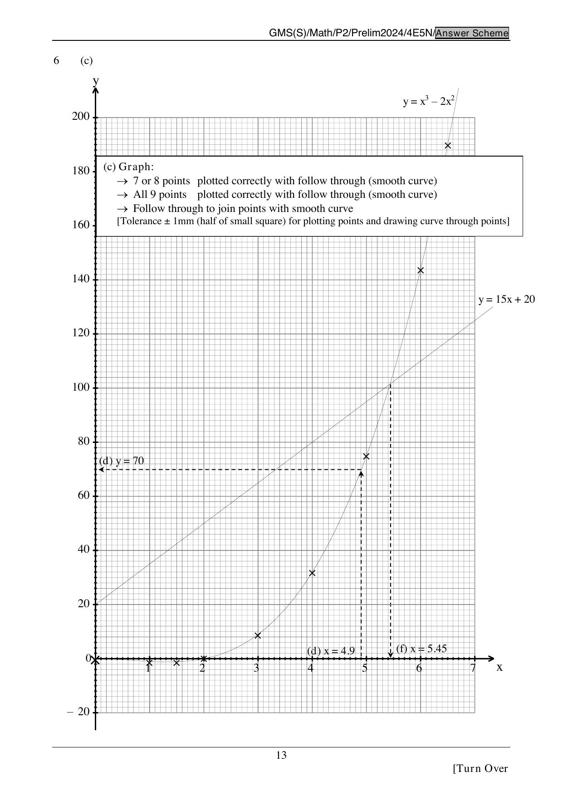

## Question

> **Marks:** 11

> **Page:** 12–13

The following diagram shows a solid which is made up of a cube whose edge is $x$ cm with a right square pyramid removed from the base of the cube. The pyramid has the same square base as the cube and its vertical height is $6$ cm.

(a) Show that the volume of the remaining solid, $y$, is $x^3 - 2x^2$. [1]

(b) Complete the table of values for $y = x^3 - 2x^2$. Values are given to one decimal place where appropriate. [1]

| $x$ | $0$ | $1$ | $1.5$ | $2$ | $3$ | $4$ | $5$ | $6$ | $6.5$ |
| --- | --- | --- | --- | --- | --- | --- | --- | --- | --- |
| $y$ | $0$ | | $-1.1$ | | $9$ | $32$ | $75$ | $144$ | $190.1$ |

(c) On the grid opposite, draw the graph of $y = x^3 - 2x^2$ for $0 \le x \le 6.5$. [3]

(d) Use your graph to estimate the volume of the remaining solid when the pyramid has a base area of $24$ cm$^2$. [2]

(e) (i) Use your graph, for $0 < x < 2$, to give a possible deduction on the volume of the remaining solid, $y$. [1]

(ii) Suggest a suitable range of $x$ such that it is possible to remove a full right square pyramid from the cube. [1]

(f) By drawing the line $y = ax + b$, solve the equation $-x^3 + 2x^2 + 15x + 20 = 0$. [2]

## Answer Scheme

(a) Volume of the solid is the volume of the cube minus the volume of the pyramid.

$$y = x \times x \times x - \left(\frac{1}{3} \times x \times x \times 6\right) = x^3 - 2x^2$$

(b) The missing values are $y = -1$ when $x = 1$, and $y = 0$ when $x = 2$.

(c) Plot all $9$ points and join them with a smooth curve. Follow-through is allowed. Tolerance is $\pm 1$ mm (half of a small square).

(d) Base area $24$ cm$^2$ gives $x = \sqrt{24} = 4.9$. From the graph, $y = (70 \pm 2)$ cm$^3$. The scheme notes the actual value $y = 69.6$.

(e) (i) For $0 < x < 2$, the graph is below the $y$-axis, so the volume is negative. The volume of the pyramid is greater than the volume of the cube, and removing the pyramid is not possible.

(ii) $x \ge 6$.

(f) Draw $y = 15x + 20$. From the graph, the intersection is $x = (5.45 \pm 0.1)$. The scheme notes the actual value $x = 5.45$.
