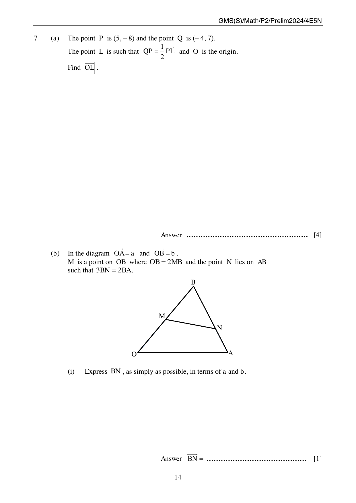

## Question

> **Marks:** 12

> **Page:** 14–15

(a) The point $P$ is $(5, -8)$ and the point $Q$ is $(-4, 7)$. The point $L$ is such that $\overrightarrow{QP} = \dfrac{1}{2}\overrightarrow{PL}$ and $O$ is the origin. Find $|\overrightarrow{OL}|$. [4]

(b) In the diagram $\overrightarrow{OA} = \mathbf{a}$ and $\overrightarrow{OB} = \mathbf{b}$. $M$ is a point on $OB$ where $OB = 2MB$ and the point $N$ lies on $AB$ such that $3BN = 2BA$.

(i) Express $\overrightarrow{BN}$, as simply as possible, in terms of $\mathbf{a}$ and $\mathbf{b}$. [1]

(ii) Express $\overrightarrow{MN}$, as simply as possible, in terms of $\mathbf{a}$ and $\mathbf{b}$. [2]

(iii) The point $P$ lies on $OA$ produced such that $OA : OP = 1 : 2$. Determine whether the points $M$, $N$ and $P$ are collinear. Justify your answer. [2]

(iv) The point $Q$ is such that $k\overrightarrow{BQ} = \mathbf{a}$ and $ONQ$ is a straight line. Write down the value of $k$. [2]

(v) Find the ratio area of triangle $BMN$ : area of triangle $OBA$. [1]

## Answer Scheme

(a)

$$\overrightarrow{QP} = \begin{pmatrix} 9 \\ -15 \end{pmatrix}$$

$$\overrightarrow{OL} = \begin{pmatrix} 23 \\ -38 \end{pmatrix}$$

$$|\overrightarrow{OL}| = \sqrt{23^2 + (-38)^2} = 44.4 \text{ units (3 s.f.)}$$

(b) (i)

$$\overrightarrow{BN} = \frac{2}{3}\mathbf{a} - \frac{2}{3}\mathbf{b}$$

(ii)

$$\overrightarrow{MN} = \frac{2}{3}\mathbf{a} - \frac{1}{6}\mathbf{b}$$

(iii) $\overrightarrow{OA} : \overrightarrow{OP} = 1 : 2$, so $\overrightarrow{OP} = 2\mathbf{a}$.

$$\overrightarrow{MP} = 2\mathbf{a} - \frac{1}{2}\mathbf{b} = 3\overrightarrow{MN}$$

$\overrightarrow{MP}$ and $\overrightarrow{MN}$ have the same direction, and $N$ lies on $MP$, so $M$, $N$ and $P$ are collinear.

(iv) $\overrightarrow{BQ}$ is parallel to $\overrightarrow{OA}$. The scheme takes $\overrightarrow{BQ} = 2\mathbf{a}$, so $k = \dfrac{1}{2}$.

(v) The scheme diagram gives the ratio $1 : 3$.
