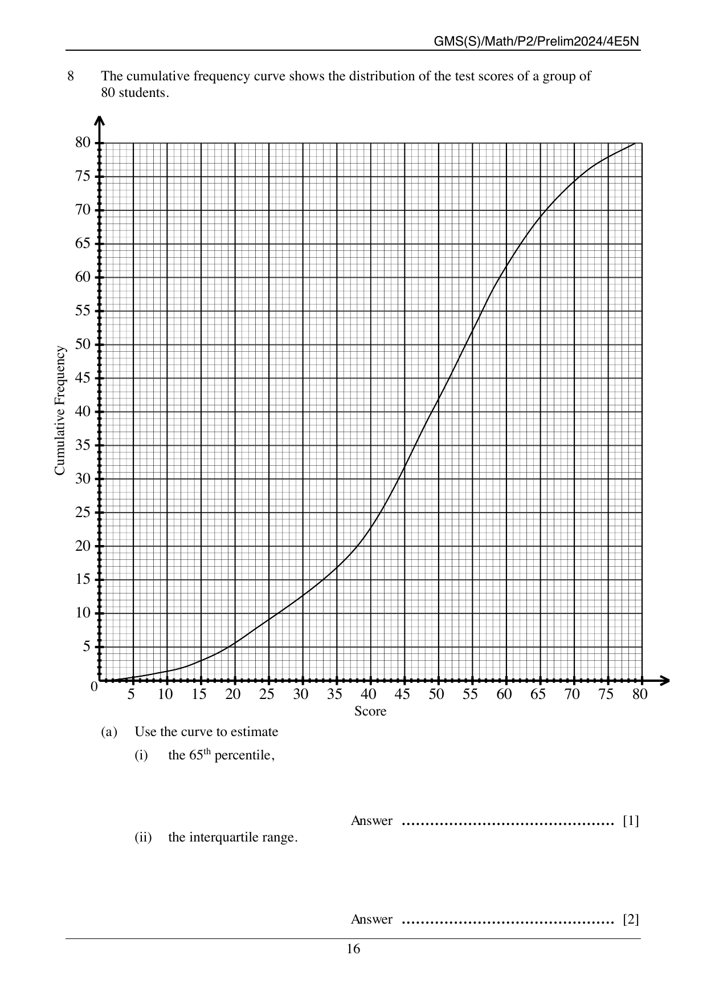
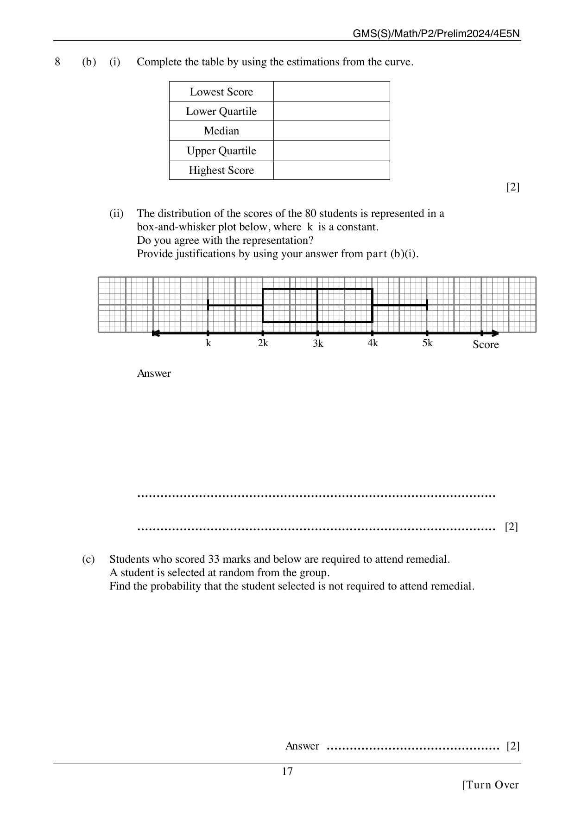
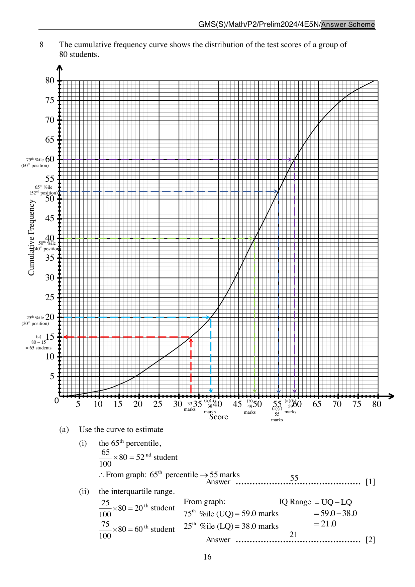

## Question

> **Marks:** 9

> **Page:** 16–17

The cumulative frequency curve shows the distribution of the test scores of a group of $80$ students.

(a) Use the curve to estimate

(i) the 65th percentile, Prelim 2008 q11 [1]

(ii) the interquartile range. [2]

(b) (i) Complete the table by using the estimations from the curve. [2]

| | |
| --- | --- |
| Lowest Score | |
| Lower Quartile | |
| Median | |
| Upper Quartile | |
| Highest Score | |

(ii) The distribution of the scores of the $80$ students is represented in a box-and-whisker plot below, where $k$ is a constant. Do you agree with the representation? Provide justifications by using your answer from part (b)(i). [2]

(c) Students who scored $33$ marks and below are required to attend remedial. A student is selected at random from the group. Find the probability that the student selected is not required to attend remedial. [2]

## Answer Scheme

(a) (i) $\dfrac{65}{100} \times 80 = 52$nd student. From the graph, the 65th percentile is $55$ marks.

(ii) Lower quartile is the 20th student, $38.0$ marks. Upper quartile is the 60th student, $59.0$ marks.

Interquartile range $= 59.0 - 38.0 = 21.0$.

(b) (i)

| | |
| --- | --- |
| Lowest Score | $2.0$ (or $3.0$) |
| Lower Quartile | $38.0$ |
| Median | $49.0$ |
| Upper Quartile | $59.0$ |
| Highest Score | $79.0$ |

(ii) Disagree. The printed plot spaces $k$, $2k$, $3k$, $4k$ and $5k$ equally. The readings are $2.0$, $38.0$, $49.0$, $59.0$ and $79.0$. Lengths: whisker $1$ is $36$, whisker $2$ is $20$, box $1$ is $11$ and box $2$ is $10$, so whisker $1$ is longer than whisker $2$, which is longer than box $1$, which is longer than box $2$. Any comment substantiated with logical reasons is accepted.

(c) From the graph, $33$ marks is the 15th student. Students not required to attend remedial: $80 - 15 = 65$.

$$\frac{65}{80} = \frac{13}{16}$$
