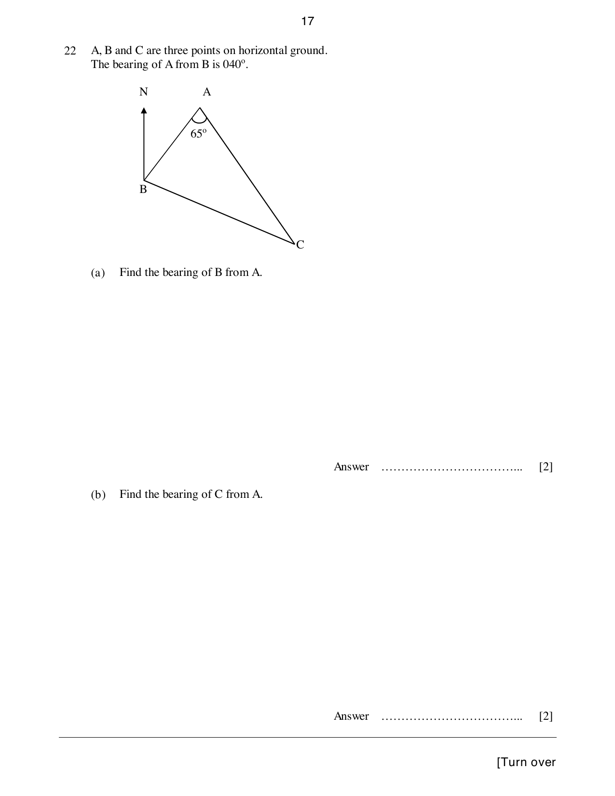

## Question

> **Marks:** 4
> **Page:** 17

$A$, $B$ and $C$ are three points on horizontal ground. The bearing of $A$ from $B$ is $040^{\circ}$.

(a) Find the bearing of $B$ from $A$. [2]

(b) Find the bearing of $C$ from $A$. [2]

## Answer Scheme

(a) Bearing of $B$ from $A = 180+040 = 220^{\circ}$. M1, A1.

(b) Bearing of $C$ from $A = 180-(65-040) = 155^{\circ}$. M1, A1.
