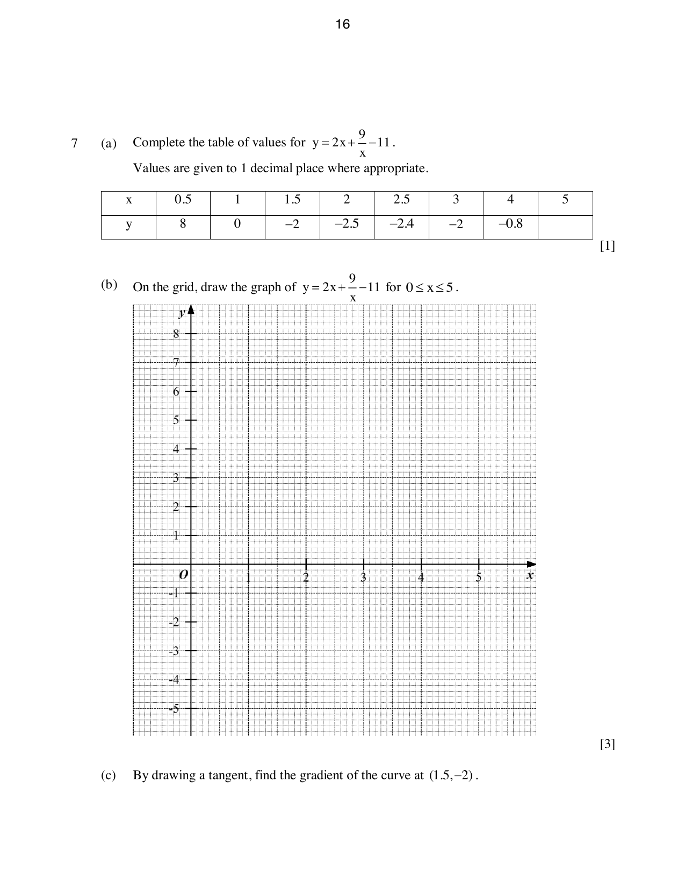

## Question

> **Marks:** 11
> **Page:** 16–17

(a) Complete the table of values for $y = 2x+\dfrac{9}{x}-11$. Values are given to 1 decimal place where appropriate. [1]

| $x$ | 0.5 | 1 | 1.5 | 2 | 2.5 | 3 | 4 | 5 |
| --- | --- | --- | --- | --- | --- | --- | --- | --- |
| $y$ | 8 | 0 | $-2$ | $-2.5$ | $-2.4$ | $-2$ | $-0.8$ | |

(b) On the grid, draw the graph of $y = 2x+\dfrac{9}{x}-11$ for $0 \leq x \leq 5$. [3]

(c) By drawing a tangent, find the gradient of the curve at $(1.5, -2)$. [2]

(d) (i) On the same axes, draw the graph of the straight line $2y = 12-3x$. [1]

(ii) Write down the $x$-coordinates of the points where the graphs meet. [2]

(iii) These values of $x$ are the solutions of the equation $7x^{2}+Ax+B = 0$. Find the value of $A$ and the value of $B$. [2]

## Answer Scheme

(a) The missing value, at $x = 5$, is completed from the equation. The scheme does not print a separate value for this cell.

(b) P2 for plotting all points correctly. P1 for plotting at least 6 points correctly. C1 for a smooth curve.

(c) Tangent drawn correctly. Gradient $-2\pm 0.2$. M1, A1.

(d) (i) Straight line passing through $(0, 6)$ and $(4, 0)$. B1.

(ii) $0.6\pm 0.05$ and $4.2\pm 0.05$. B1, B1.

(iii) From $2\left(2x+\dfrac{9}{x}-11\right) = 12-3x$,

$$
4x+\frac{18}{x}-22 = 12-3x
$$

$$
4x^{2}+18-22x = 12x-3x^{2}
$$

$$
7x^{2}-34x+18 = 0
$$

$A = -34$, $B = 18$. M1, M1, A1.
