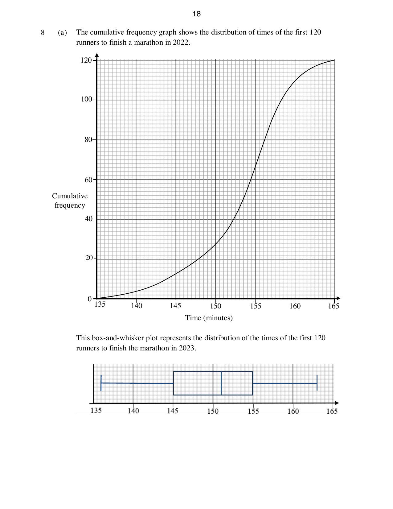

## Question

> **Marks:** 11
> **Page:** 18–20

(a) The cumulative frequency graph shows the distribution of times of the first 120 runners to finish a marathon in 2022.

The same page also shows the box-and-whisker plot of the times of the first 120 runners to finish the marathon in 2023. On that plot the left whisker starts near 136 minutes, the box runs from 145 to 155 minutes, the median is near 151 minutes, and the right whisker ends near 163 minutes.

(i) Use the two diagrams to complete this table for the two marathons. [3]

| Year | Lower quartile | Median | Upper quartile | Interquartile range |
| --- | --- | --- | --- | --- |
| 2022 | | 154.5 | | |
| 2023 | 145 | | 155 | 10 |

(ii) Simon says that the runners in 2022 were quicker on average. Do you agree? Give a reason for your answer. [1]

(iii) Complete the frequency table below for the runners in 2023. [2]

| Time (minutes) | Frequency |
| --- | --- |
| $135 < t \leq 140$ | 4 |
| $140 < t \leq 145$ | |
| $145 < t \leq 150$ | 32 |
| $150 < t \leq 155$ | 28 |
| $155 < t \leq 160$ | |
| $160 < t \leq 165$ | 9 |

(b) In a game two dice are used. Die A has 2 blue faces and 4 yellow faces. Die B has 4 blue faces and 2 pink faces. The two dice are thrown together.

(i) Find the probability that

(a) both dice show a blue face on top, [1]

(b) just one die shows a blue face on top. [2]

(ii) If both dice show blue, the player wins a prize. If just one shows blue, the player throws both dice again. He also wins a prize if both show blue on the second throw. Calculate the probability that the player wins a prize on either the first throw or the second throw. [2]

## Answer Scheme

(a) (i)

| Year | Lower quartile | Median | Upper quartile | Interquartile range |
| --- | --- | --- | --- | --- |
| 2022 | 150.5 | | 157 | 6.5 |
| 2023 | | 151 | | |

M1 for the lower or upper quartile. A1 for the interquartile range. B1 for the median. The 2022 median and the 2023 lower quartile, upper quartile and interquartile range are printed on the question paper.

(ii) No, I do not agree. The mean time for the runners in 2023 is lower than the mean time in 2022. B1.

(iii)

| Time (minutes) | Frequency |
| --- | --- |
| $135 < t \leq 140$ | 4 |
| $140 < t \leq 145$ | 26 |
| $145 < t \leq 150$ | 32 |
| $150 < t \leq 155$ | 28 |
| $155 < t \leq 160$ | 21 |
| $160 < t \leq 165$ | 9 |

B1, B1.

(b) (i) (a) $\dfrac{1}{3}\times \dfrac{2}{3} = \dfrac{2}{9}$. B1.

(b) $\left(\dfrac{1}{3}\times \dfrac{1}{3}\right)+\left(\dfrac{2}{3}\times \dfrac{2}{3}\right) = \dfrac{5}{9}$. M1, A1.

(ii) $\dfrac{2}{9}+\left(\dfrac{5}{9}\times \dfrac{2}{9}\right) = \dfrac{28}{81}$. M1, A1.
