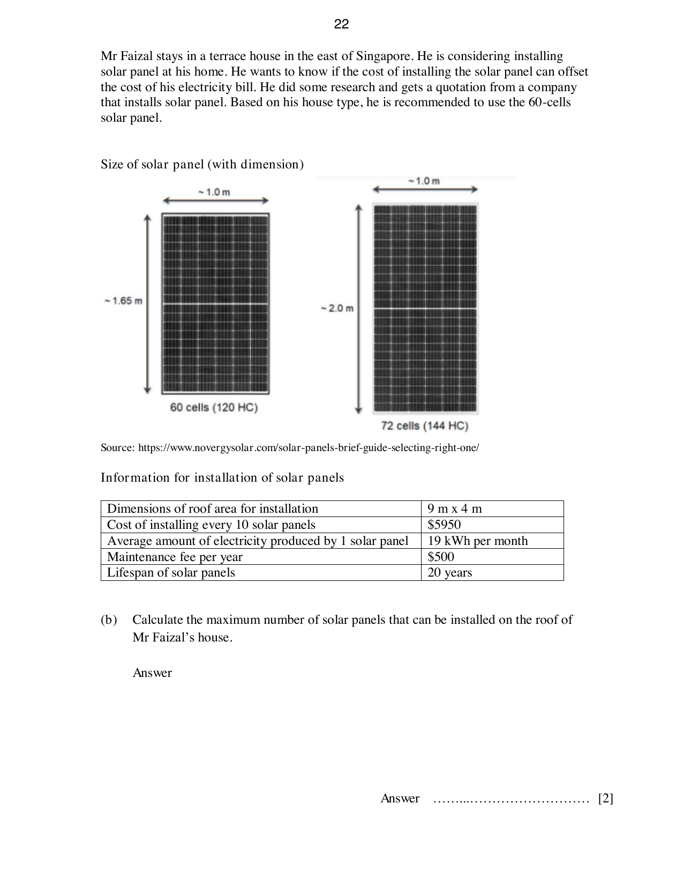

## Question

> **Marks:** 10
> **Page:** 21–23

Electricity tariffs are regulated by the Energy Market Authority (EMA) of Singapore and revised quarterly to reflect the actual cost of electricity. The cost of electricity per kilowatt (kWh) is known as the electricity tariff rate, which is revised every quarter by SP power.

Quarterly household electricity tariff, in cents per kWh, price before GST:

| Quarter | Jul–Sep 22 | Oct–Dec 22 | Jan–Mar 23 | Apr–Jun 23 | Jul–Sep 23 | Oct–Dec 23 | Jan–Mar 24 |
| --- | --- | --- | --- | --- | --- | --- | --- |
| Cents/kWh | 30.17 | 29.74 | 28.95 | 27.43 | 27.74 | 28.70 | 29.89 |

Mr Faizal’s average electricity consumption in January to March 2024:

| Month | Jan 24 | Feb 24 | Mar 24 |
| --- | --- | --- | --- |
| Electricity consumption (kWh) | 727 | 682 | 769 |

(a) Show that Mr Faizal paid ＄217 on average per month for his family consumption from January to March 2024. [2]

Mr Faizal stays in a terrace house in the east of Singapore. He is considering installing a solar panel at his home. He wants to know if the cost of installing the solar panel can offset the cost of his electricity bill. He did some research and gets a quotation from a company that installs solar panels. Based on his house type, he is recommended to use the 60-cells solar panel.

The figure shows two panel sizes: a 60-cell (120 HC) panel of about $1.65\text{ m}$ by $1.0\text{ m}$, and a 72-cell (144 HC) panel of about $2.0\text{ m}$ by $1.0\text{ m}$.

Source: https://www.novergysolar.com/solar-panels-brief-guide-selecting-right-one/

Information for installation of solar panels:

| | |
| --- | --- |
| Dimensions of roof area for installation | $9\text{ m} \times 4\text{ m}$ |
| Cost of installing every 10 solar panels | ＄5950 |
| Average amount of electricity produced by 1 solar panel | 19 kWh per month |
| Maintenance fee per year | ＄500 |
| Lifespan of solar panels | 20 years |

(b) Calculate the maximum number of solar panels that can be installed on the roof of Mr Faizal’s house. [2]

(c) Using your answer in (a) and (b), determine if Mr Faizal should proceed with the installation of solar panels. Justify your answer and show your calculations clearly. State one assumption you have used. [6]

## Answer Scheme

The scheme numbers this question as 10.

(a) Amount paid before GST. The scheme uses $737$, $692$ and $749$; their mean is the same as the question-paper values $727$, $682$ and $769$.

$$
\frac{737+692+749}{3}\times 0.2989 = 726\times 0.2989 = \text{＄}217
$$

M1, A1. The rate $0.2989$ dollars per kWh is the January to March 2024 tariff, $29.89$ cents per kWh.

(b) $9 \div 1.65 \approx 5$, $4 \div 1 = 4$, and $5\times 4 = 20$. M1, A1.

(c) Method 1.

Average amount of electricity produced $= 20\times 19 = 380\text{ kWh}$. P1.

Average cost per month after solar energy savings $= (726-380)\times$ ＄$0.2989 =$ ＄$103.42$. C1.

Average cost of installing and maintaining the solar panels per month

$$
= (2\times \text{＄}5950+20\times \text{＄}500)\div (20\times 12) = \text{＄}91.25
$$

I1.

Total average amount paid per month after installation $= \text{＄}103.42+\text{＄}91.25 = \text{＄}194.67$ (less than ＄217). T1.

Since the average amount paid by Mr Faizal after installing the solar panels is less than what he is currently paying, he should proceed with the installation. A1 for the conclusion.

Assumption, either one: the average electricity consumption remains the same, or the price of the tariff did not increase. A1.

Method 2, total cost based on 20 years.

Average amount of electricity produced $= 20\times 19 = 380\text{ kWh}$. P1.

Cost for 20 years before installation $= \text{＄}217\times 20\times 12 = \text{＄}52080$. C1.

Cost of installation and maintenance $= (2\times \text{＄}5950+20\times \text{＄}500) = \text{＄}21900$. I1.

Total cost for 20 years after installation

$$
= (726-380)\times \text{＄}0.2989\times 12\times 20+21900 = 46720.66
$$

which is less than ＄52080. T1.

Since the total amount paid by Mr Faizal after installing the solar panels is less than what he is currently paying, he should proceed with the installation. A1.
