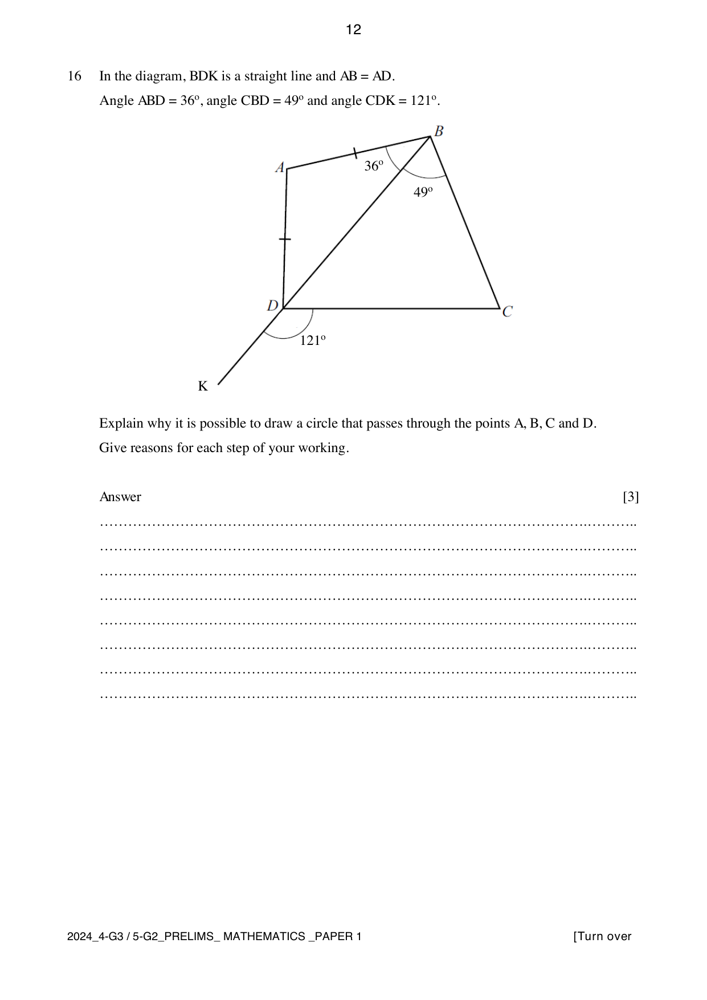

## Question

> **Marks:** 3
> **Page:** 12

In the diagram, $BDK$ is a straight line and $AB = AD$. Angle $ABD = 36^{\circ}$, angle $CBD = 49^{\circ}$ and angle $CDK = 121^{\circ}$.

Explain why it is possible to draw a circle that passes through the points $A$, $B$, $C$ and $D$. Give reasons for each step of your working. [3]

## Answer Scheme

If a circle can pass through $A$, $B$, $C$ and $D$, then angle $DAB+$ angle $DCB = 180^{\circ}$ (angles in opposite segments).

Angle $ADB =$ angle $ABD = 36^{\circ}$ (isosceles triangle). Angle $DAB = 180^{\circ}-36^{\circ}-36^{\circ} = 108^{\circ}$ (sum of angles in a triangle). M1.

Angle $BDC = 180^{\circ}-121^{\circ} = 59^{\circ}$ (adjacent angles on a straight line). Angle $DCB = 180^{\circ}-59^{\circ}-49^{\circ} = 72^{\circ}$ (sum of angles in a triangle). M1.

So angle $DAB+$ angle $DCB = 108^{\circ}+72^{\circ} = 180^{\circ}$ (angles in opposite segments). A1.

Since the two angles add to $180^{\circ}$, a circle can pass through $A$, $B$, $C$ and $D$. Any step without a reason, or with an incorrect reason more than once, deduct 1 mark from the overall score for this question.
