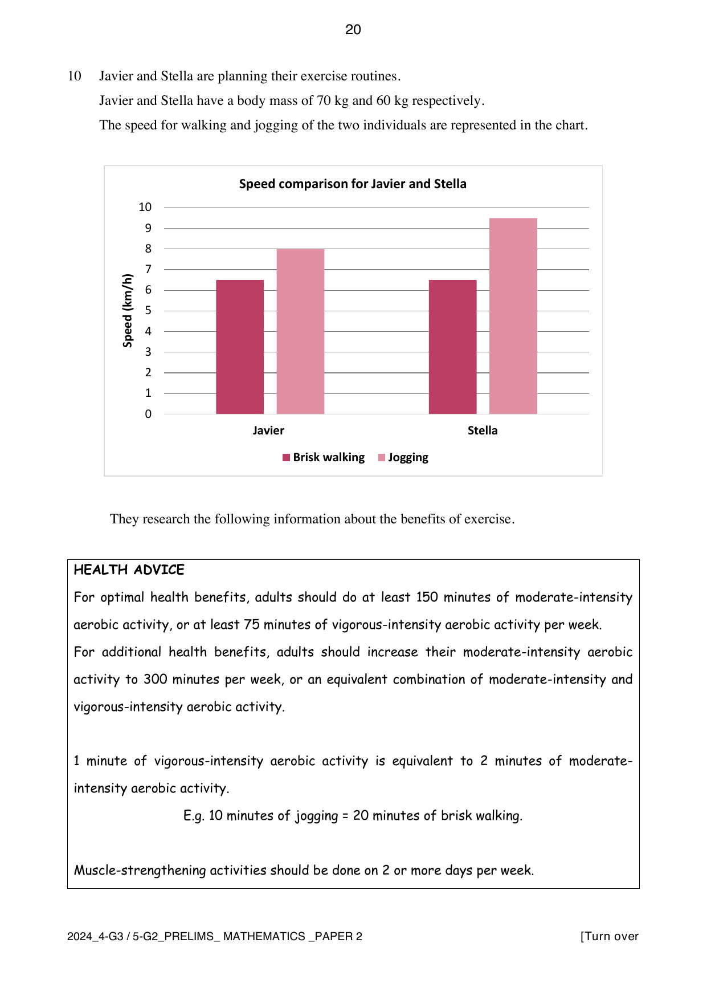

## Question

> **Marks:** 10
> **Page:** 20–24

Javier and Stella are planning their exercise routines. Javier and Stella have a body mass of $70\text{ kg}$ and $60\text{ kg}$ respectively. The speed for walking and jogging of the two individuals is represented in the chart.

On the chart, brisk walking is $6.5\text{ km/h}$ for both Javier and Stella. Jogging is $8\text{ km/h}$ for Javier and $9.5\text{ km/h}$ for Stella.

They research the following information about the benefits of exercise.

**Health advice**

For optimal health benefits, adults should do at least 150 minutes of moderate-intensity aerobic activity, or at least 75 minutes of vigorous-intensity aerobic activity per week.

For additional health benefits, adults should increase their moderate-intensity aerobic activity to 300 minutes per week, or an equivalent combination of moderate-intensity and vigorous-intensity aerobic activity.

1 minute of vigorous-intensity aerobic activity is equivalent to 2 minutes of moderate-intensity aerobic activity. For example, 10 minutes of jogging $= 20$ minutes of brisk walking.

Muscle-strengthening activities should be done on 2 or more days per week.

Approximate calories burned during 30 minutes of aerobic exercise:

| | 60 kg | 70 kg | 80 kg | 90 kg |
| --- | --- | --- | --- | --- |
| Walking $5\text{ km/h}$ | 105 | 120 | 135 | 150 |
| Walking $6.5\text{ km/h}$ | 130 | 150 | 170 | 190 |
| Jogging $8\text{ km/h}$ | 240 | 280 | 315 | 350 |
| Jogging $9.5\text{ km/h}$ | 300 | 345 | 390 | 435 |

Non-aerobic muscle-strengthening activities:

- 1 hour of yoga burns approximately 3 calories per kilogram of body mass.
- 1 hour of weight training burns approximately 4 calories per kilogram of body mass.

(a) In their first week of exercise, they each plan to go for four brisk walks. They will walk the same route each time. The four walks together meet the minimum target for the time for optimal health benefits in one week.

(i) Find the distance of one of these walks. [2]

(ii) Find out how many more calories Javier burns in these four walks than Stella. [1]

(b) After one month, they change their routines. Javier wants to gain additional health benefits. He decides to do a $4\text{ km}$ walk 3 times per week and do a $6\text{ km}$ jog 2 times per week. He will also attend a 45-minute yoga class 2 times per week.

Stella wants to maintain optimal health benefits. She decides to do an $8\text{ km}$ jog 2 times per week. She will also attend a 30-minute weight training session 2 times per week.

Javier says: we will both meet our targets for exercise. However, I will burn about $50\%$ more calories than Stella during our exercise per week.

Is Javier correct? Justify your decision with clear calculations. [7]

## Answer Scheme

(a) (i) The four walks take 150 minutes in total. Brisk walking is moderate intensity, and both walk at $6.5\text{ km/h}$.

$$
150\text{ min correspond to }\frac{6.5}{60}\times 150 = 16.25\text{ km}
$$

Distance of one walk $= \dfrac{16.25}{4} = 4\dfrac{1}{16} = 4.0625\text{ km}$. M1, A1.

(ii) In every 30 minutes the difference is $150-130 = 20$ calories, so in 150 minutes the difference is 100 calories. B1.

(b) Javier, additional health benefits.

Walking: $4\text{ km}$ three times is $12\text{ km}$ per week at $6.5\text{ km/h}$, so $\dfrac{12}{6.5}\times 60 = 110\dfrac{10}{13}$ minutes. Jogging: $6\text{ km}$ twice is $12\text{ km}$ at $8\text{ km/h}$, so $90$ minutes. J1 for Javier’s walking or jogging time. Vigorous time converts as $90\times 2 = 180$ minutes of moderate activity.

Calories: walking, $30$ minutes gives $150$ calories, so $110\dfrac{10}{13}$ minutes gives $553\dfrac{11}{13}$ calories. Jogging, $30$ minutes gives $280$ calories, so $90$ minutes gives $840$ calories. Yoga, $90$ minutes at $3$ calories per kilogram: $4.5\times 70 = 315$ calories. JC1 for any one calorie total counted correctly.

Overall calories $= 553\dfrac{11}{13}+840+315 = 1709$ to the nearest integer.

Total moderate-equivalent time $= 180+110\dfrac{10}{13} = 290\dfrac{10}{13}$ minutes, which is less than $300$ minutes. JT1 for Javier’s total time.

Stella, optimal health benefits.

Jogging: $8\text{ km}$ twice is $16\text{ km}$ at $9.5\text{ km/h}$, so $101\dfrac{1}{19}$ minutes, which is more than $75$ minutes. S1 for Stella’s jogging time. The scheme’s later line says “yoga” for this session; the activity is weight training at $4$ calories per kilogram. $60$ minutes gives $4\times 60 = 240$ calories.

Jogging calories: $30$ minutes gives $300$ calories, so $101\dfrac{1}{19}$ minutes gives $1010\dfrac{10}{19}$ calories. Overall $= 1010\dfrac{10}{19}+240 = 1251$ to the nearest integer. SC1 for Stella’s total calories.

$$
\frac{1709-1251}{1251}\times 100\% = 37\%
$$

to the nearest integer, which is less than $50\%$. M1, with error carried forward, for the percentage comparison.

Javier burns about $37\%$ more, not $50\%$ more, and only Stella meets her target. Javier is incorrect. A1, with error carried forward, for a conclusion based on the calculations.
