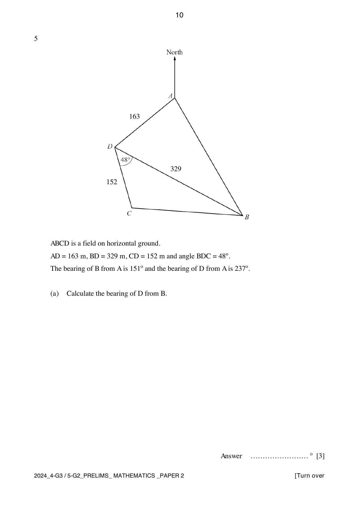

## Question

> **Marks:** 7
> **Page:** 10–11

$ABCD$ is a field on horizontal ground. $AD = 163\text{ m}$, $BD = 329\text{ m}$, $CD = 152\text{ m}$ and angle $BDC = 48^{\circ}$. The bearing of $B$ from $A$ is $151^{\circ}$ and the bearing of $D$ from $A$ is $237^{\circ}$.

(a) Calculate the bearing of $D$ from $B$. [3]

(b) Calculate the distance from $B$ to $C$. [2]

(c) An aircraft is flying above $D$. Find the angle of elevation of the aircraft from $C$ when it is $245\text{ m}$ vertically above $D$. [2]

## Answer Scheme

(a) Angle $BAD = 237^{\circ}-151^{\circ} = 86^{\circ}$.

$$
\frac{\sin \angle ABD}{163} = \frac{\sin 86^{\circ}}{329}
$$

Angle $ABD = 29.61924^{\circ}$. M1.

Bearing of $D$ from $B = 360^{\circ}-29.61924^{\circ}-(180^{\circ}-151^{\circ}) = 360^{\circ}-29.61924^{\circ}-29^{\circ} = 301.4^{\circ}$. M1, A1.

(b) $BC^{2} = 152^{2}+329^{2}-2(152)(329)\cos 48^{\circ} = 64421.23327$, so $BC = 253.81338 = 254\text{ m}$. M1, A1.

(c) $\tan \theta = \dfrac{245}{152}$, so $\theta = 58.2^{\circ}$. M1, A1.
