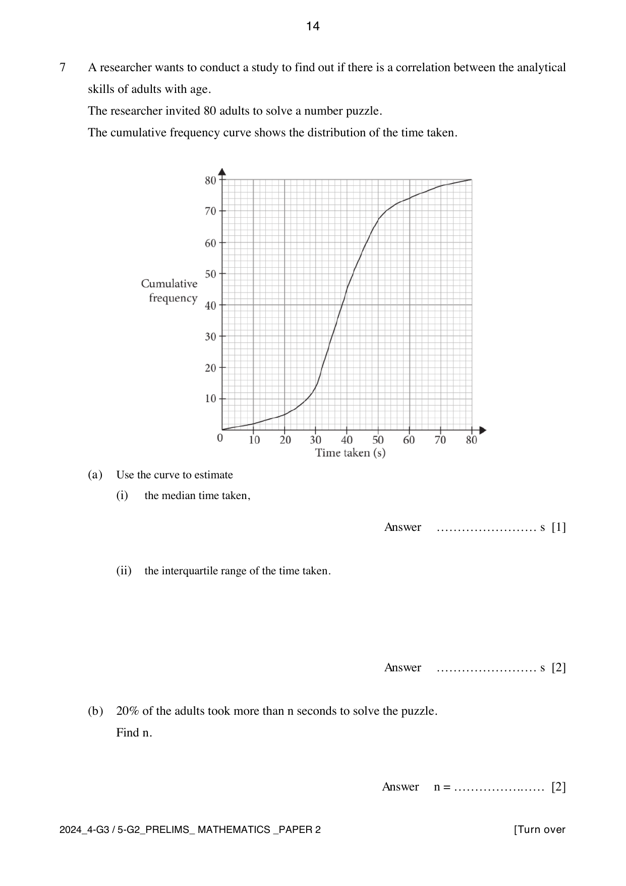
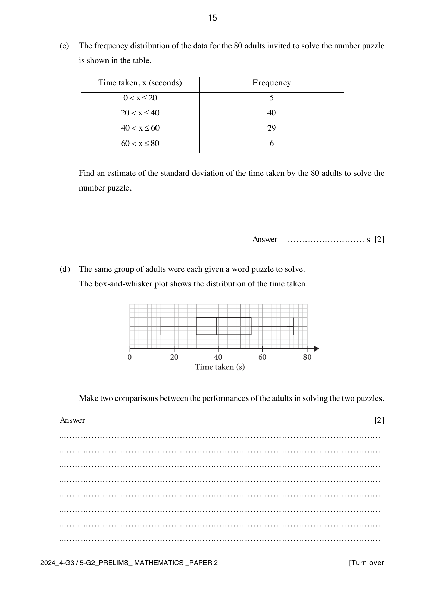

## Question

> **Marks:** 9
> **Page:** 14–15

A researcher wants to conduct a study to find out if there is a correlation between the analytical skills of adults and age. The researcher invited 80 adults to solve a number puzzle. The cumulative frequency curve shows the distribution of the time taken.

(a) Use the curve to estimate

(i) the median time taken, [1]

(ii) the interquartile range of the time taken. [2]

(b) $20\%$ of the adults took more than $n$ seconds to solve the puzzle. Find $n$. [2]

(c) The frequency distribution of the data for the 80 adults invited to solve the number puzzle is shown in the table.

| Time taken, $x$ (seconds) | Frequency |
| --- | --- |
| $0 < x \leq 20$ | 5 |
| $20 < x \leq 40$ | 40 |
| $40 < x \leq 60$ | 29 |
| $60 < x \leq 80$ | 6 |

Find an estimate of the standard deviation of the time taken by the 80 adults to solve the number puzzle. [2]

(d) The same group of adults were each given a word puzzle to solve. The box-and-whisker plot shows the distribution of the time taken.

Make two comparisons between the performances of the adults in solving the two puzzles. [2]

## Answer Scheme

(a) (i) Median $= 38$ or $39$ seconds. B1.

(ii) Upper quartile $= 46$ seconds, lower quartile $= 32$ seconds. M1 for either. Interquartile range $= 46-32 = 14\text{ s}$. A1.

(b) The 80th percentile is the 64th term, $n = 48\text{ s}$. M1, A1.

(c)

$$
\sqrt{\frac{5(10)^{2}+40(30)^{2}+29(50)^{2}+6(70)^{2}}{80}-\left(\frac{5(10)+40(30)+29(50)+6(70)}{80}\right)^{2}}
$$

$$
= \sqrt{\frac{138400}{80}-\left(\frac{3120}{80}\right)^{2}} = 14.4568 = 14.5
$$

M1, A1.

(d) From the box plot, the word-puzzle median is $39\text{ s}$ and the interquartile range is $25\text{ s}$. The number-puzzle median is $38$ or $39\text{ s}$ and the interquartile range is $14\text{ s}$.

- There was no significant difference in the average performance. The median values were about the same, or equal. A1.
- The adults had a greater spread of timings, so less consistency, on the word puzzle, because the interquartile range was higher. A1.

The maximum mark from error carried forward is 1.
